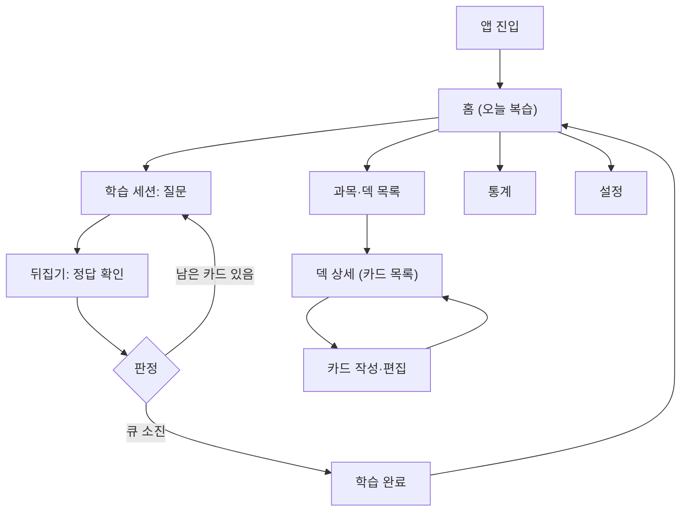
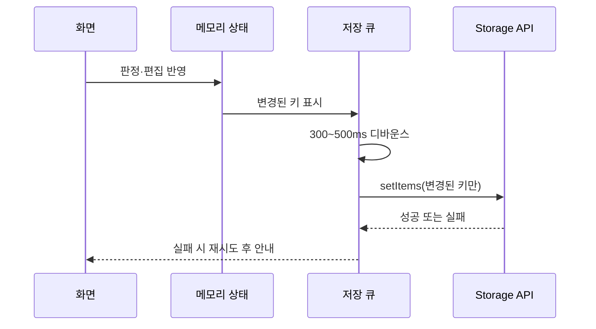
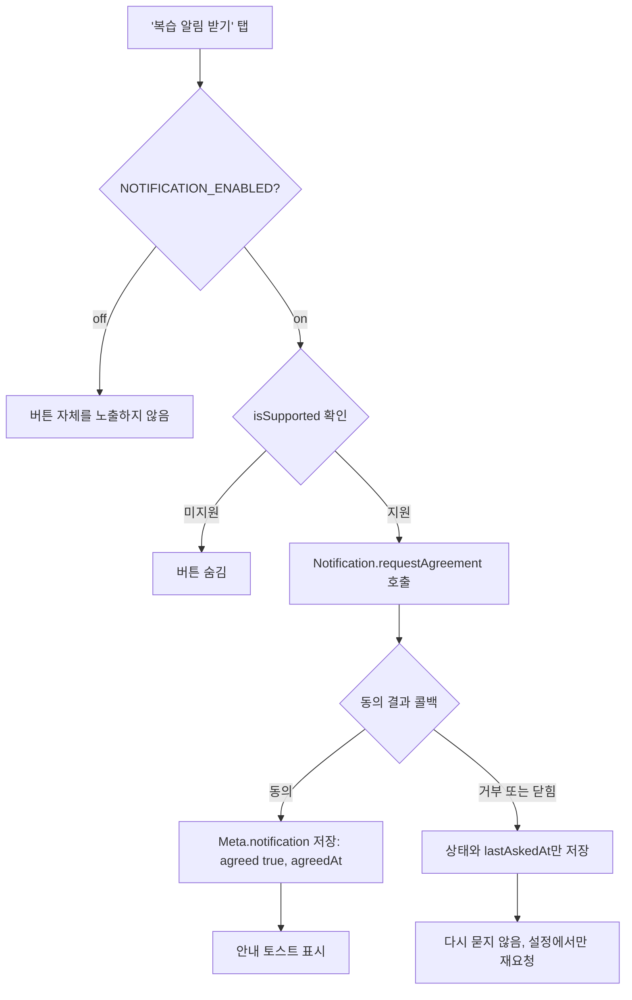
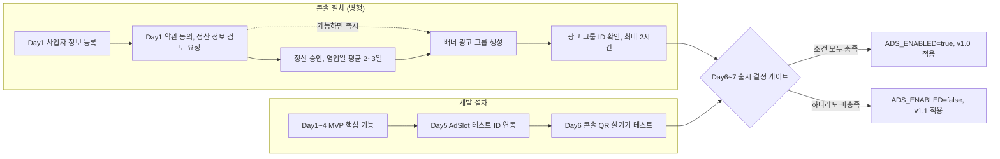

# 복습큐 개발 기획서

| 항목         | 내용                                                                                                                                                          |
| ---------- | ----------------------------------------------------------------------------------------------------------------------------------------------------------- |
| 프로젝트명      | 복습큐                                                                                                                                                         |
| 영문명        | ReviewQ (Review + Queue) **[가정]**                                                                                                                           |
| appName 후보 | `reviewq`. 딥링크는 `intoss://reviewq`이다. 콘솔에 등록할 수 있는지 **[검증 필요]** ([시작하기](https://developers-apps-in-toss.toss.im/documentation/integration/getting-started)) |
| 문서 버전      | v1.0                                                                                                                                                        |
| 작성일        | 2026-10-26                                                                                                                                                  |
| 대상 플랫폼     | 앱인토스 WebView                                                                                                                                                |
| 개발 형태      | 1인 개발                                                                                                                                                       |
| MVP 기간     | 5\~7일                                                                                                                                                       |
| 기본 스택      | React + TypeScript + Vite, `@apps-in-toss/web-framework` 3.x                                                                                                |

> **표기 규칙**
>
> - **[확인]** 공식 문서나 공지로 확인한 사실이다. 출처 링크를 함께 적는다.
> - **[가정]** 설계상 가정이나 결정이다. 근거 문서는 없으며 운영 중 바꿀 수 있다.
> - **[검증 필요]** 착수 전이나 실기기에서 확인해야 할 사항이다. 확인 전에는 지원된다고 단정하지 않는다.
>
> 이 문서는 **기획서**다. 프로젝트 생성, 코드 구현, Git 작업은 포함하지 않는다. 문서 안의 코드 블록은 설계를 설명하기 위한 예시다.

---

## 0. 기능 범위 및 기술적 타당성 분석 (요약)

### 0.1 결론

| 항목                              | 판단                                                        | 근거                                                                                                                                                                                                                                                                                                                                                                                                                                                                                                                                 |
| ------------------------------- | --------------------------------------------------------- | ---------------------------------------------------------------------------------------------------------------------------------------------------------------------------------------------------------------------------------------------------------------------------------------------------------------------------------------------------------------------------------------------------------------------------------------------------------------------------------------------------------------------------------- |
| WebView SDK 3.x + React/TS/Vite | **타당함**                                                   | **[확인]** WebView SDK 패키지는 `@apps-in-toss/web-framework`이고 `npx ait init`으로 초기화한다. 3.x는 Vite 플러그인 `aitDevtools.vite()`로 로컬 브라우저 테스트를 지원한다. ([시작하기](https://developers-apps-in-toss.toss.im/documentation/integration/getting-started), [SDK 3.x](https://developers-apps-in-toss.toss.im/documentation/integration/sdk-3.x))                                                                                                                                                                                                        |
| 로컬 저장 (Storage API)             | **타당함**, 단 용량·유실 위험 있음                                    | **[확인]** 네이티브 저장소에 문자열을 저장하고, 앱을 종료했다가 다시 실행해도 유지된다. ([Storage](https://developers-apps-in-toss.toss.im/documentation/sdk/domains-api/storage)) **[검증 필요]** 공식 문서에 용량 한도가 명시되어 있지 않다.                                                                                                                                                                                                                                                                                                                                              |
| 백엔드·로그인 없는 MVP                  | **타당함**                                                   | **[확인]** 검수 체크리스트는 종료 후 재접속해도 데이터가 유지될 것을 요구한다. 로컬 저장으로 충족할 수 있다. ([비게임 출시 가이드](https://developers-apps-in-toss.toss.im/checklist/app-nongame)) **[가정]** 토스 로그인은 쓰지 않는다.                                                                                                                                                                                                                                                                                                                                                           |
| 간격 반복 (고정 간격 방식)                | **타당함**                                                   | **[가정]** 순수 함수 하나로 구현할 수 있고 서버가 필요 없다. 6장에서 상세 설계한다.                                                                                                                                                                                                                                                                                                                                                                                                                                                                               |
| 배너 광고                           | **기술적으로 가능**. 착수 Day 1에 광고 그룹(배너)을 신청하고, 출시 시점에 조건부로 적용한다 | **[확인]** WebView 배너 API가 있다. 콘솔 절차는 사업자 정보 등록 → 정산 정보 등록(검토 영업일 평균 2\~3일) → 광고 그룹 생성 순이다. 광고 그룹 ID는 구글에 등록되기까지 최대 2시간이 걸릴 수 있다. 샌드박스에서는 인앱 광고를 테스트할 수 없다. ([배너 광고](https://developers-apps-in-toss.toss.im/documentation/common/monetization/iaa/web-banner), [인앱 광고 가이드](https://developers-apps-in-toss.toss.im/guide/monetization/in-app-ad)) **[가정]** ID 발급 시점을 앞당기려고 개발 첫날 신청한다. 개발은 테스트 ID로 진행한다. 상세는 10장에 있다.                                                                                                               |
| 알림                              | **조건부 적용 가능** (사용자 동의 + 콘솔 승인 시)                          | **[확인]** `Notification.requestAgreement`로 알림 동의 화면을 띄우고, 동의 결과를 콜백으로 받는다. 콘솔의 '토스에게 발송 요청하기'는 서버 개발과 토스 로그인 없이 쓸 수 있다. 이 방식은 알림 동의문 설정이 필수이고, 소재 검토가 승인된 뒤에 활성화한다. 푸시는 기능성 메시지로만 보낼 수 있고, 리텐션 같은 광고 목적의 내용은 넣을 수 없다. ([Notification](https://developers-apps-in-toss.toss.im/documentation/sdk/domains-api/notification), [푸시알림 가이드](https://developers-apps-in-toss.toss.im/guide/marketing/smart-message), [공지](https://techchat-apps-in-toss.toss.im/t/topic/3927)) **[검증 필요]** 복습 안내 문구가 기능성 메시지로 승인되는지는 아직 모른다. 상세는 9.4절에 있다. |

### 0.2 주요 리스크 Top 5와 대응

| 순위  | 리스크                             | 영향                            | 대응                                                                                                                                                                  |
| --- | ------------------------------- | ----------------------------- | ------------------------------------------------------------------------------------------------------------------------------------------------------------------- |
| 1   | 기기 변경, 토스 앱 재설치 시 데이터 유실        | 학습 기록 전체 손실                   | 앱 안에 '기기에만 저장됨'을 고지한다. P1에서 텍스트(JSON) 백업 내보내기를 제공한다. 근거는 커뮤니티 제기 사항이다. ([커뮤니티](https://techchat-apps-in-toss.toss.im/t/topic/3597))                                 |
| 2   | Storage 용량 한도 미확인               | 카드가 많으면 저장 실패 가능              | 키를 덱·월 단위로 분할한다. 실기기에서 3,000장을 저장·로드해 측정한다. **[검증 필요]**                                                                                                             |
| 3   | 날짜·시간대 오류                       | 복습일이 하루 밀리거나 당겨짐              | 로컬 날짜 문자열(`YYYY-MM-DD`)만 쓰고, 달력 일 단위로 계산한다. 단위 테스트로 막는다. **[가정]**                                                                                                   |
| 4   | 검수 반려 (내비게이션 바, 뒤로가기, 라이트 모드 등) | 출시 지연. 재검수에 영업일 3\~5일         | 출시 가이드 체크리스트를 개발 단계부터 반영한다. ([비게임 출시 가이드](https://developers-apps-in-toss.toss.im/checklist/app-nongame), [FAQ](https://developers-apps-in-toss.toss.im/guide/faq)) |
| 5   | SDK 3.x 롤백 불가                   | 3.x 번들을 출시한 뒤에는 2.x로 돌아갈 수 없음 | 처음부터 3.1.1 이상 최신 버전으로 시작하고 2.x는 고려하지 않는다. **[확인]** ([SDK 3.x](https://developers-apps-in-toss.toss.im/documentation/integration/sdk-3.x))                           |

### 0.3 기존 요청 스택 유지 판단

**React + TypeScript + Vite를 유지한다.**

- **[확인]** 3.x의 build 스크립트는 `vite build && ait build`이다. 로컬 테스트는 `@apps-in-toss/devtools`의 Vite 플러그인 `aitDevtools.vite()`로 한다. CLI 3.0.2 이상으로 스캐폴딩하면 자동으로 설정된다. ([SDK 3.x](https://developers-apps-in-toss.toss.im/documentation/integration/sdk-3.x))
- **[확인]** 검수 정책은 SSR을 금지하고 CSR/SSG만 허용한다. Vite 기반 React SPA는 CSR이므로 정책에 맞는다. ([비게임 출시 가이드](https://developers-apps-in-toss.toss.im/checklist/app-nongame))
- **[확인]** 2026년 10월 5일부터 SDK 3.x 미만은 콘솔 신규 등록이 제한된다. 신규 프로젝트는 3.x가 필수다. ([공지](https://techchat-apps-in-toss.toss.im/t/sdk-3-x-10-5/4776))

---

## 1. 프로젝트 개요 및 개발 목표

### 1.1 서비스 한 줄 정의

> **복습큐는 토스 안에서 설치 없이 바로 여는 플래시카드 앱이다. 오늘 복습할 카드를 한 화면에 모아 '기억함/기억 못 함' 두 버튼으로 판정하고, 다음 복습일을 자동으로 정한다.**

### 1.2 개발 목표

| #   | 목표                 | 측정 기준                                                                                                                             |
| --- | ------------------ | --------------------------------------------------------------------------------------------------------------------------------- |
| G1  | 1분 안에 첫 카드 만들기     | 첫 진입에서 과목·덱·카드 1장 생성까지 1분 이내 **[가정]**                                                                                             |
| G2  | 오늘 복습 큐를 한 화면에서 시작 | 홈에서 탭 1번으로 학습 세션 진입                                                                                                               |
| G3  | 재실행 후 데이터 유지       | 앱 종료 후 재실행해도 카드·일정·로그가 그대로 유지 **[확인]** ([Storage](https://developers-apps-in-toss.toss.im/documentation/sdk/domains-api/storage)) |
| G4  | 검수 통과              | 비게임 출시 가이드 전 항목 충족 ([비게임 출시 가이드](https://developers-apps-in-toss.toss.im/checklist/app-nongame))                                  |

### 1.3 비목표 (Non-goals)

MVP에서는 다음을 하지 않는다. **[가정]**

- 로그인(토스 로그인 포함)
- 기기 간 동기화, 서버 저장
- 서버 기반 개인화 복습 알림(예: '오늘 23장' 같은 카드 수 안내). 동의 기반 정기 알림은 조건부로 포함한다(9.4절).
- 이미지·음성 카드
- AI 기반 카드 자동 생성

---

## 2. 타깃 사용자와 사용 시나리오

### 2.1 페르소나

대상 사용자군은 사용자 요구사항에서 정했다. 세부 특성은 \*\*[가정]\*\*이다.

| 페르소나    | 목표             | 사용 상황          | 핵심 니즈                   |
| ------- | -------------- | -------------- | ----------------------- |
| 학생      | 시험 범위 개념·용어 암기 | 쉬는 시간, 등하교 중   | 과목별로 나눠 관리, 빠른 복습       |
| 자격증 준비생 | 기출 개념 반복 암기    | 퇴근 후, 주말 집중 학습 | 많은 카드를 빠르게 등록, 밀린 복습 처리 |
| 어학 학습자  | 단어·표현 장기 기억    | 출퇴근 중 짧은 시간    | 매일 조금씩, 오늘 할 양이 명확함     |
| 면접 준비생  | 예상 질문 답변 숙달    | 면접 전 며칠간 반복    | 질문-답변 형태 카드, 반복 연습      |

### 2.2 대표 시나리오

**시나리오 A. 출퇴근 5분 복습 (어학 학습자)**

1. 지하철에서 토스를 열고 복습큐에 진입한다.
2. 홈에서 '오늘 복습 23장'을 확인하고 시작 버튼을 누른다.
3. 카드를 탭해 정답을 확인하고, 하단 버튼으로 기억 여부를 판정한다.
4. 완료 화면에서 다음 복습 예정 수를 보고 홈으로 돌아간다.

**시나리오 B. 시험 전 카드 대량 등록 (자격증 준비생)**

1. 과목 '정보처리'와 덱 '3과목 데이터베이스'를 만든다.
2. 카드 작성 화면에서 질문과 정답을 입력하고 '저장 후 계속'으로 연속 등록한다.
3. 등록을 마치면 덱 상세에서 카드 수를 확인한다.
4. 다음 날 홈에서 신규 카드와 복습 카드를 함께 학습한다.

**시나리오 C. 면접 질문 반복 연습 (면접 준비생)**

1. 덱 '1차 면접 예상 질문'에 질문과 핵심 답변을 카드로 넣는다.
2. 오늘 큐를 끝낸 뒤 일정을 바꾸지 않는 '추가 연습'(P1)으로 한 번 더 돌린다.
3. 기억 못 한 질문은 다음 날 다시 큐에 나온다.

---

## 3. 유사 서비스와 차별화 방향

### 3.1 유사 서비스 유형 비교

아래 비교는 서비스 유형별 일반적 특징이다. 특정 서비스의 수치나 가격은 다루지 않는다. 실제 시장조사는 \*\*[검증 필요]\*\*다.

| 유형               | 일반적 특징                | 복습큐 관점의 한계            |
| ---------------- | --------------------- | --------------------- |
| Anki류 고급 SRS 앱   | 정교한 간격 반복, 다양한 설정과 확장 | 설치·설정 부담, 초보자에게 진입 장벽 |
| Quizlet류 학습 세트 앱 | 학습 세트 공유, 여러 학습 모드    | 간격 반복보다 세트 단위 학습 중심   |
| 일반 메모 앱          | 자유로운 기록, 접근성 높음       | 복습 일정 관리 기능 없음        |

### 3.2 차별화 방향 **[가정]**

- **설치 없이 바로 실행**: 토스 안에서 미니앱으로 열린다. 딥링크는 `intoss://{appName}` 형식이다. **[확인]** ([시작하기](https://developers-apps-in-toss.toss.im/documentation/integration/getting-started))
- **두 버튼 판정**: '기억함/기억 못 함'만 고른다. 난이도 점수를 고민할 필요가 없다.
- **오늘 할 일 중심 홈**: 홈 첫 화면에 오늘 복습 수와 시작 버튼을 둔다.
- **설명 가능한 간격**: 판정 버튼 아래에 '기억함 → 7일 뒤', '기억 못 함 → 내일'처럼 다음 복습일을 미리 보여 준다.

---

## 4. MVP 기능 명세 및 우선순위

### 4.1 데이터 계층과 입력 제한

\*\*과목(Subject) &gt; 카드 묶음(덱, Deck) &gt; 카드(Card)\*\*의 3단 계층으로 구성한다.

| 대상  | 입력 제한 **[가정]** | 비고                         |
| --- | -------------- | -------------------------- |
| 과목명 | 1\~30자         | 앞뒤 공백 제거 후 검사              |
| 덱명  | 1\~30자         | 같은 과목 안에서 중복 허용 여부는 경고만 표시 |
| 질문  | 1\~500자        | 줄바꿈 허용                     |
| 정답  | 1\~500자        | 줄바꿈 허용                     |

### 4.2 기능 명세

| ID  | 기능            | 우선순위     | 상세                                                                                                                                   | 완료 조건                                                                              |
| --- | ------------- | -------- | ------------------------------------------------------------------------------------------------------------------------------------ | ---------------------------------------------------------------------------------- |
| F1  | 과목 CRUD       | P0       | 생성·이름 변경·삭제. 삭제 시 하위 덱·카드도 삭제                                                                                                        | 생성·수정·삭제가 재실행 후에도 반영됨                                                              |
| F2  | 덱 CRUD        | P0       | 과목 하위에 생성·이름 변경·이동·삭제                                                                                                                | 덱별 카드 수가 정확히 표시됨                                                                   |
| F3  | 카드 CRUD       | P0       | 질문·정답 입력, '저장 후 계속' 연속 등록                                                                                                            | 입력 제한 위반 시 저장 불가, 안내 문구 표시                                                         |
| F4  | 카드 뒤집기        | P0       | 카드 탭으로 질문 → 정답 전환                                                                                                                    | 탭 반응이 즉시 일어나고 2초 이상 지연 없음                                                          |
| F5  | 판정 기록         | P0       | 기억함·기억 못 함 버튼, ReviewLog 기록                                                                                                          | 판정마다 로그 1건 생성, 연타 시 1회만 처리                                                         |
| F6  | 다음 복습일 계산     | P0       | 고정 간격 스케줄러(6장)                                                                                                                       | 6.2 규칙 표의 모든 케이스가 단위 테스트를 통과                                                       |
| F7  | 오늘 복습 목록      | P0       | dueDate가 오늘 이하인 카드, 오래 밀린 순                                                                                                          | 홈 숫자와 세션 카드 수가 일치                                                                  |
| F8  | 재실행 후 유지      | P0       | Storage API 저장·로드                                                                                                                    | 종료 후 재실행 시 모든 데이터 유지                                                               |
| F9  | 진행률·기본 통계     | P1       | 오늘 완료 수, 단계별 카드 분포, 최근 7일 학습 수                                                                                                       | 로그 기반 수치가 수동 계산과 일치                                                                |
| F10 | 데이터 내보내기      | P1       | 전체 데이터를 텍스트(JSON)로 백업                                                                                                                | 내보낸 텍스트가 스키마 검증을 통과                                                                |
| F11 | 삭제 확인·실행 취소   | P1       | 삭제 전 확인, 삭제 직후 일정 시간 실행 취소                                                                                                           | 실행 취소 시 원래 상태로 복원                                                                  |
| F12 | 추가 연습 모드      | P1       | 일정에 반영하지 않는 반복 학습                                                                                                                    | 추가 연습 후 dueDate 변화 없음                                                              |
| F13 | 백업 가져오기       | P2       | JSON 텍스트 복원                                                                                                                          | 후속                                                                                 |
| F14 | 배너 광고         | P1 (조건부) | 착수 Day 1에 콘솔에서 배너 광고 그룹을 신청한다. `AdSlot`을 테스트 ID로 연동하고, 출시 직전에 발급된 광고 그룹 ID로 교체한다. 기능 플래그 `ADS_ENABLED`로 관리한다                         | 광고 그룹 ID가 발급되고 10장 검수 체크리스트를 통과하면 v1.0에서 켠다. 하나라도 충족하지 못하면 플래그 off로 출시하고 v1.1에서 켠다 |
| F15 | 복습 알림 (동의 기반) | P1 (조건부) | 학습 완료 화면과 설정의 '복습 알림 받기'에서 `Notification.requestAgreement`를 호출한다. 동의한 사용자는 콘솔 정기 발송 캠페인의 대상이 된다. 기능 플래그 `NOTIFICATION_ENABLED`로 관리한다 | 동의·거부 모두 정상 동작하고, 거부해도 다른 기능에 영향이 없다. 알림 동의문과 소재가 승인되기 전에는 플래그 off를 유지한다           |
| F16 | 로그인·동기화       | P2       | 기기 간 데이터 이전                                                                                                                          | 후속                                                                                 |
| F17 | 개인화 알림        | P2       | 사용자별 복습 카드 수를 담은 알림(서버·로그인·sendMessage API 필요)                                                                                       | 후속                                                                                 |

### 4.3 MVP와 후속 기능 분리

| 구분         | 포함 기능                                 | 목표 시점 **[가정]**                                                                                |
| ---------- | ------------------------------------- | --------------------------------------------------------------------------------------------- |
| MVP (v1.0) | F1\~F8 (P0)                           | 5\~7일 개발 기간 안                                                                                 |
| MVP 여유분    | F9\~F12 (P1)                          | 기간 안에 여유가 있으면 포함, 없으면 v1.0.x                                                                  |
| MVP 조건부    | F14 배너 광고, F15 동의 기반 알림               | 코드는 MVP 기간에 구현한다. 콘솔 승인(광고 그룹 ID 발급, 알림 동의문·소재 승인)이 검수 제출 전에 끝나면 v1.0에서 켜고, 아니면 플래그 off로 출시한다 |
| v1.1       | F13 백업 가져오기, 조건부 기능 중 v1.0에서 켜지 못한 기능 | 콘솔 승인 완료 후                                                                                    |
| v1.2 이후    | F16 로그인·동기화, F17 개인화 알림, SM-2/FSRS 검토 | 리뷰 로그 축적 후                                                                                    |

---

## 5. 사용자 흐름 및 화면별 UI 구성

### 5.1 사용자 흐름



### 5.2 화면 구성

| 화면       | 주요 구성 요소                         | 주요 동작                 | 비고                  |
| -------- | -------------------------------- | --------------------- | ------------------- |
| 홈        | 오늘 복습 수, 연체 수, 시작 버튼, 과목별 요약     | 시작 → 학습 세션, 과목 탭 → 목록 | 최초 화면. 뒤로가기 시 종료    |
| 과목·덱 목록  | 과목 목록, 과목별 덱 목록, 추가 버튼           | 과목·덱 생성, 이름 변경, 삭제    | 삭제 확인(P1)           |
| 덱 상세     | 카드 목록(질문 미리보기, 다음 복습일), 카드 추가    | 카드 편집 진입, 이 덱만 학습     | 빈 상태 안내 문구          |
| 카드 작성·편집 | 질문 입력, 정답 입력, 글자 수, 저장           | 저장, 저장 후 계속, 삭제       | 가상 키보드 대응           |
| 학습 세션    | 진행 표시(n/전체), 카드, 하단 판정 버튼 2개     | 탭으로 뒤집기, 판정           | 뒤집기 전에는 판정 버튼 비활성   |
| 학습 완료    | 완료 수, 기억함 비율, 내일 예정 수            | 홈으로, 추가 연습(P1)        | 광고를 둔다면 후보 위치(v1.1) |
| 통계       | 단계별 분포, 최근 7일 학습량                | 조회만                   | P1                  |
| 설정       | 백업 내보내기, 데이터 초기화, 앱 정보, 저장 위치 고지 | 내보내기, 전체 삭제           | 전체 삭제는 2단계 확인       |

### 5.3 모바일·터치 원칙

| 원칙     | 내용                               | 표기                                                                                     |
| ------ | -------------------------------- | -------------------------------------------------------------------------------------- |
| 판정 버튼  | 화면 하단 고정, 최소 높이 48px, 두 버튼 좌우 배치 | **[가정]**                                                                               |
| 뒤집기    | 카드 영역 어디를 탭해도 뒤집힌다               | **[가정]**                                                                               |
| 한 손 조작 | 주요 동작을 화면 하단 절반에 둔다              | **[가정]**                                                                               |
| 가상 키보드 | 입력창이 키보드에 가리지 않도록 스크롤·여백을 처리한다   | **[검증 필요]** Android 실기기 확인                                                             |
| 핀치 줌   | 제스처 확대·축소를 비활성화한다                | **[확인]** ([비게임 출시 가이드](https://developers-apps-in-toss.toss.im/checklist/app-nongame)) |
| 라이트 모드 | 라이트 모드로 고정한다                     | **[확인]** (같은 출처)                                                                       |
| 응답 속도  | 인터랙션이 2초 이상 지연되지 않게 한다           | **[확인]** (같은 출처)                                                                       |

### 5.4 앱인토스 내비게이션 바 규칙

- **[확인]** 앱인토스 내비게이션 바를 사용한다. 자체 로고를 넣지 않고, 기능 버튼은 최대 1개다. 더보기(⋯)에서 공통 기능을 제공한다. ([비게임 출시 가이드](https://developers-apps-in-toss.toss.im/checklist/app-nongame))
- **[확인]** 토스 뒤로가기와 자체 뒤로가기 버튼을 동시에 노출하지 않는다. 따라서 화면 안에 자체 뒤로가기 버튼을 두지 않는다. (같은 출처)
- **[확인]** 최초 화면(홈)에서 뒤로가기를 누르면 미니앱이 종료된다. (같은 출처)
- **[확인]** Android 시스템 백버튼으로 뒤로가기 또는 종료가 되어야 한다. 앱 내부 화면 스택과 브라우저 히스토리를 연동한다. (같은 출처)
- **[확인]** 진입하자마자 바텀시트를 띄우지 않는다. 첫 실행 안내도 홈 안의 카드 형태로 둔다. (같은 출처)
- **[확인]** 모든 화면에서 나가는 방법이 명확해야 한다. 학습 세션 중 뒤로가기는 '세션 종료' 확인으로 처리한다. (같은 출처)
- **[검증 필요]** 탭바를 둔다면 플로팅 형태로 한다. 전체 폭 고정 바는 반려된다는 내용은 커뮤니티 블로그 정보다. ([커뮤니티 블로그](https://wonkeylab.kr/log/apps-in-toss-launch-checklist/)) MVP는 탭바 없이 홈 중심 구조로 간다. **[가정]**

---

## 6. 간격 반복 알고리즘 상세 설계

### 6.1 방식

**[가정]** 고정 간격 단계 방식(Leitner 변형)을 쓴다.

- 간격표: `INTERVALS = [1, 3, 7, 14, 30, 60]` (단위: 일)
- stage 0은 신규 카드 또는 실패로 초기화된 상태다.
- stage 1\~6은 각각 `INTERVALS[stage-1]`일 간격에 대응한다.

### 6.2 규칙

| 상황               | 결과                  | 다음 stage      | 다음 복습일                               |
| ---------------- | ------------------- | ------------- | ------------------------------------ |
| 신규 카드 첫 학습, 기억함  | 단계 진입               | 1             | 오늘+1일                                |
| 신규 또는 복습, 기억 못 함 | 초기화, 세션 끝에 1회 재출제   | 0             | 오늘+1일                                |
| 복습 성공            | 한 단계 상승(마지막 단계면 유지) | stage+1, 최대 6 | 오늘+`INTERVALS[stage-1]` (새 stage 기준) |
| 연체 카드 성공         | 한 단계만 상승, 연체 보너스 없음 | stage+1, 최대 6 | 오늘+`INTERVALS[stage-1]`              |
| 연체 카드 실패         | 초기화                 | 0             | 오늘+1일                                |
| 세션 내 재출제 카드 판정   | 일정에 반영하지 않음         | 변화 없음         | 변화 없음                                |

추가 규칙은 다음과 같다. **[가정]**

- **오늘 큐 구성**: dueDate가 오늘 이하인 카드를 모두 넣고, dueDate가 오래된 순으로 정렬한다. 같으면 생성일 순이다.
- **하루 표시 상한**: 기본 100장이다. 초과분은 다음 날로 넘어간다고 홈과 완료 화면에서 안내한다. 넘어간 카드의 dueDate는 바꾸지 않는다. 다음 날에도 연체 카드로 다시 큐에 들어간다.
- **첫 판정만 반영**: 한 세션에서 카드의 첫 판정만 일정에 반영한다. 재출제는 기억을 다지는 용도다.

### 6.3 날짜 처리 규칙

| 규칙         | 내용                                     | 표기                            |
| ---------- | -------------------------------------- | ----------------------------- |
| 저장 형식      | 기기 로컬 시간대 기준 `YYYY-MM-DD` 문자열          | **[가정]**                      |
| 하루 경계      | 로컬 00:00. 새벽 4시 경계는 후속 옵션              | **[가정]**                      |
| 계산 단위      | 달력 일 단위. 시각은 쓰지 않는다                    | **[가정]**                      |
| 포그라운드 복귀   | 오늘 날짜를 다시 계산하고 큐를 갱신한다                 | **[가정]**, 이벤트 동작은 **[검증 필요]** |
| 세션 중 자정 경과 | 진행 중인 세션은 시작 날짜 기준으로 마치고, 완료 후 새로 계산한다 | **[가정]**                      |

날짜 덧셈은 시간대·일광절약 영향을 받지 않도록 UTC 자정 기준으로 연·월·일만 계산한다.

```ts
// utils/date.ts — 달력 일 단위 계산 예시
export function todayLocal(now: Date = new Date()): string {
  const y = now.getFullYear();
  const m = String(now.getMonth() + 1).padStart(2, '0');
  const d = String(now.getDate()).padStart(2, '0');
  return `${y}-${m}-${d}`;
}

export function addDays(date: string, days: number): string {
  const [y, m, d] = date.split('-').map(Number);
  const t = new Date(Date.UTC(y, m - 1, d + days));
  return t.toISOString().slice(0, 10);
}

// 'YYYY-MM-DD' 문자열은 사전순 비교가 날짜 비교와 같다
export const isDue = (dueDate: string, today: string) => dueDate <= today;
```

### 6.4 중복·이상 상황

| 상황                | 처리                                                                             | 표기           |
| ----------------- | ------------------------------------------------------------------------------ | ------------ |
| 같은 카드를 같은 날 다시 판정 | `lastReviewedDate === today`이면 일정에 반영하지 않는다                                    | **[가정]**     |
| 판정 버튼 연타          | 처리 중 잠금. 다음 카드로 넘어갈 때까지 입력을 무시한다                                               | **[가정]**     |
| 기기 시계를 과거로 되돌림    | `today < meta.lastOpenedDate`이면 일정을 앞당기지 않고 경고만 표시한다. lastOpenedDate는 갱신하지 않는다 | **[가정]**     |
| 시간대 변경            | 해외 이동 등으로 하루가 겹치거나 빠지는 경우의 동작                                                  | **[검증 필요]**  |
| 추가 연습 모드          | 일정을 바꾸지 않고 로그에도 연습으로만 남긴다                                                      | **[가정]**, P1 |

### 6.5 교체 가능한 구조

**[가정]** 스케줄러는 인터페이스 뒤에 숨긴다. 카드마다 어떤 알고리즘·버전으로 계산했는지 기록해 두면, 나중에 알고리즘을 바꿔도 기존 카드를 판별할 수 있다. 스케줄러는 부수 효과 없는 순수 함수로 구현하고 Vitest 단위 테스트 대상으로 삼는다.

```ts
// domain/scheduler/types.ts
export type Grade = 'remember' | 'forget';

export interface CardSchedule {
  stage: number;                  // 0 = 신규·초기화
  dueDate: string;                // 'YYYY-MM-DD'
  lastReviewedDate: string | null;
  reviewCount: number;
  lapseCount: number;
  algorithmId: string;            // 예: 'fixed-interval'
  algorithmVersion: number;       // 예: 1
}

export interface Scheduler {
  id: string;
  schedule(state: CardSchedule, grade: Grade, today: string): CardSchedule;
}
```

```ts
// domain/scheduler/fixedInterval.ts — 의사코드 수준 예시
import { addDays } from '../../utils/date';
import type { Scheduler } from './types';

export const INTERVALS = [1, 3, 7, 14, 30, 60] as const;

export const fixedIntervalScheduler: Scheduler = {
  id: 'fixed-interval',
  schedule(state, grade, today) {
    // 같은 날 중복 판정은 반영하지 않는다
    if (state.lastReviewedDate === today) return state;

    const base = {
      ...state,
      lastReviewedDate: today,
      reviewCount: state.reviewCount + 1,
      algorithmId: 'fixed-interval',
      algorithmVersion: 1,
    };

    if (grade === 'forget') {
      return { ...base, stage: 0, dueDate: addDays(today, 1), lapseCount: state.lapseCount + 1 };
    }

    // 연체 여부와 관계없이 한 단계만 올린다(보너스 없음)
    const next = Math.min(state.stage + 1, INTERVALS.length);
    return { ...base, stage: next, dueDate: addDays(today, INTERVALS[next - 1]) };
  },
};
```

단위 테스트 최소 케이스는 다음과 같다.

- [ ] stage 0 + 기억함 → stage 1, 오늘+1일

- [ ] stage 3 + 기억함 → stage 4, 오늘+14일

- [ ] stage 6 + 기억함 → stage 6 유지, 오늘+60일

- [ ] 임의 stage + 기억 못 함 → stage 0, 오늘+1일, lapseCount 증가

- [ ] 같은 날 두 번째 판정 → 입력 상태 그대로 반환

- [ ] 연체 10일 카드 + 기억함 → 한 단계만 상승

- [ ] `addDays`의 월말·연말·윤년(2월 29일) 경계

### 6.6 SM-2 / FSRS 비교

| 항목            | 고정 간격 (MVP)      | SM-2        | FSRS              |
| ------------- | ---------------- | ----------- | ----------------- |
| 구현 난이도        | 낮음               | 중간          | 높음                |
| 필요 입력         | 두 버튼(기억함/기억 못 함) | 0\~5 품질 점수  | 4단계 등급과 매개변수      |
| 두 버튼 UI와의 적합성 | 그대로 맞음           | 점수 매핑 설계 필요 | 등급 매핑과 매개변수 준비 필요 |
| 설명 가능성        | 높음(간격표 그대로)      | 중간          | 낮음                |
| MVP 판단        | **채택**           | 후속 검토       | 후속 검토             |

**결론 [가정]**: MVP는 고정 간격으로 출시한다. 모든 판정을 ReviewLog에 쌓고, v1.2 이후 SM-2 또는 FSRS 도입을 검토한다. 리뷰 로그가 전환 판단과 매개변수 조정의 근거가 된다. 알고리즘 세부 공식은 이 문서에서 다루지 않는다.

---

## 7. 데이터 모델과 저장 구조

### 7.1 타입 정의

```ts
// domain/model.ts
export interface Subject {
  id: string;
  name: string;          // 1~30자
  createdAt: string;     // ISO 8601
  updatedAt: string;
}

export interface Deck {
  id: string;
  subjectId: string;
  name: string;          // 1~30자
  createdAt: string;
  updatedAt: string;
}

export interface Card {
  id: string;
  deckId: string;
  question: string;      // 1~500자
  answer: string;        // 1~500자
  createdAt: string;
  updatedAt: string;
  schedule: CardSchedule;
}

export interface CardSchedule {
  stage: number;
  dueDate: string;                  // 'YYYY-MM-DD'
  lastReviewedDate: string | null;
  reviewCount: number;
  lapseCount: number;
  algorithmId: string;
  algorithmVersion: number;
}

export interface ReviewLog {
  id: string;
  cardId: string;
  date: string;                     // 'YYYY-MM-DD' (세션 시작 날짜)
  grade: 'remember' | 'forget';
  prevStage: number;
  nextStage: number;
  reviewedAt: string;               // ISO 8601
}

export interface Meta {
  schemaVersion: number;
  lastOpenedDate: string;           // 'YYYY-MM-DD'
  installId: string;
}
```

id는 `crypto.randomUUID()`를 쓴다. 미지원 환경을 대비해 대체 생성기를 둔다. **[검증 필요]** 토스 WebView에서 `crypto.randomUUID` 지원 여부를 실기기로 확인한다.

```ts
// utils/id.ts
export function newId(): string {
  if (typeof crypto !== 'undefined' && typeof crypto.randomUUID === 'function') {
    return crypto.randomUUID();
  }
  // 대체 생성기: 충돌 가능성은 낮지만 0은 아니다
  return `${Date.now().toString(36)}-${Math.random().toString(36).slice(2, 10)}`;
}
```

### 7.2 저장소 선택

**[확인]** 앱인토스 Storage API를 쓴다. ([Storage SDK](https://developers-apps-in-toss.toss.im/documentation/sdk/domains-api/storage), [파일 저장소](https://developers-apps-in-toss.toss.im/documentation/common/file-storage/storage))

- 모바일 앱의 로컬(네이티브) 저장소에 **문자열** 데이터를 읽고 쓴다.
- API: `Storage.getItem`, `getItems`(여러 값 한 번에), `setItem`, `setItems`(여러 값 한 번에), `removeItem`, `clearItems`
- Promise 기반이다. 예: `setItem(key: string, value: string): Promise<void>`
- 앱을 종료했다가 다시 실행해도 데이터가 유지되어야 할 때 쓰는 API다.
- 가져오기: `import { Storage } from '@apps-in-toss/web-framework'`

값은 `JSON.stringify`로 직렬화한 문자열로 저장한다. **[가정]**

### 7.3 키 설계

| 키                   | 값           | 분할 기준 | 비고                 |
| ------------------- | ----------- | ----- | ------------------ |
| `bq:meta`           | Meta        | 단일    | 가장 먼저 로드           |
| `bq:subjects`       | Subject[]   | 단일    | 개수가 적음             |
| `bq:decks`          | Deck[]      | 단일    | 개수가 적음             |
| `bq:cards:{deckId}` | Card[]      | 덱 단위  | 카드 수정 시 해당 덱 키만 저장 |
| `bq:logs:{YYYY-MM}` | ReviewLog[] | 월 단위  | 당월 키만 자주 쓰임        |
| `bq:backup:last`    | 전체 스냅샷 1개   | 단일    | 직전 정상 로드본          |

**[가정]** 분할하는 이유는 두 가지다. 첫째, 용량 한도가 공식 문서에서 확인되지 않는다. 둘째, 한 번에 쓰는 문자열 크기를 줄여 저장 시간과 실패 범위를 줄인다. 덱 목록에 있는 deckId로 카드 키 목록을 구성하고, 로그 키는 Meta에 월 목록을 두어 찾는다.

### 7.4 읽기·쓰기 정책



| 단계       | 정책                                                | 표기                                                                                     |
| -------- | ------------------------------------------------- | -------------------------------------------------------------------------------------- |
| 시작       | `getItems`로 필요한 키를 일괄 로드한다                        | **[가정]**                                                                               |
| 변경       | 메모리 상태에 먼저 반영하고 변경된 키를 표시한다                       | **[가정]**                                                                               |
| 저장       | 300\~500ms 디바운스 후 변경된 키만 `setItems`로 저장한다         | **[가정]**                                                                               |
| 근거       | 브릿지(SDK API) 과도 호출, 반복문·타이머 중복 호출 금지 정책           | **[확인]** ([비게임 출시 가이드](https://developers-apps-in-toss.toss.im/checklist/app-nongame)) |
| 백그라운드 전환 | 대기 중인 변경을 즉시 flush한다                              | **[가정]**, `visibilitychange` 동작은 **[검증 필요]**                                           |
| 실패       | 재시도 횟수·간격을 제한한다(예: 3회, 지수 백오프). 최종 실패 시 사용자에게 알린다 | 정책은 **[확인]**(같은 출처), 수치는 **[가정]**                                                      |

### 7.5 무결성

- **마이그레이션 [가정]**: `Meta.schemaVersion`을 기준으로 버전별 마이그레이션 함수를 순서대로 적용한다. 각 함수는 이전 버전 데이터를 받아 다음 버전 데이터를 돌려주는 순수 함수다.
- **형식 검증 [가정]**: 로드 시 필수 필드 존재, 타입, 날짜 형식(`[0-9]{4}-[0-9]{2}-[0-9]{2}`), 문자열 길이를 수동으로 검증한다. 외부 검증 라이브러리는 쓰지 않는다.
- **복구 [가정]**: 검증에 실패하면 자동으로 덮어쓰지 않는다. `bq:backup:last`로 복구할지 사용자에게 묻는다. 로드와 검증이 성공했을 때만 백업본을 갱신한다.

### 7.6 용량 추정

| 항목               | 값                             | 표기          |
| ---------------- | ----------------------------- | ----------- |
| 카드 1장            | 약 0.5\~1KB (질문·정답·일정 포함 JSON) | **[가정]**    |
| 카드 1,000장        | 약 1MB 내외                      | **[가정]**    |
| Storage 공식 용량 한도 | 문서에 명시 없음                     | **[검증 필요]** |

실기기 측정 항목은 다음과 같다.

- [ ] Android 실기기에서 카드 3,000장 저장 시간 측정

- [ ] 같은 데이터의 앱 시작 로드 시간 측정(2초 이상이면 지연 정책 위반 위험)

- [ ] 키 하나에 큰 문자열을 저장할 때 실패 여부 확인

- [ ] 저장 실패 시 반환되는 오류 형태 확인

### 7.7 데이터 유실 위험

| 원인              | 영향                     | 대응                                                                                                       |
| --------------- | ---------------------- | -------------------------------------------------------------------------------------------------------- |
| 기기 변경           | 새 기기에서 데이터 없음          | '기기에만 저장됨' 고지, 백업 내보내기(P1), 후속 로그인·동기화                                                                   |
| 토스 앱 재설치·데이터 삭제 | 전체 데이터 삭제              | 같은 대응. 설정에 마지막 백업 날짜 표시 **[가정]**                                                                         |
| Storage 손상      | 로드 실패                  | 형식 검증, `bq:backup:last` 복구                                                                               |
| 중고 기기 양도        | 다음 사용자에게 이전 데이터 노출 가능성 | 설정에서 전체 삭제(`clearItems`) 제공. 커뮤니티에서 제기된 우려다 ([커뮤니티](https://techchat-apps-in-toss.toss.im/t/topic/3597)) |
| 저장 실패           | 최근 변경 유실               | 재시도 제한, 실패 안내, 다음 변경 시 재저장                                                                               |

> **백업 범위 정리**: 텍스트(JSON) 백업 **내보내기는 P1**, \*\*가져오기는 P2(v1.1)\*\*로 둔다. 클립보드 복사와 파일 저장을 지원하는지는 \*\*[검증 필요]\*\*다. 확인 전에는 화면에 텍스트를 보여 주고 사용자가 직접 복사하는 방식을 최소 경로로 둔다. **[가정]**

### 7.8 StorageAdapter 추상화

**[가정]** 저장소는 인터페이스로 감싼다. 실기기와 토스 앱에서는 Storage API 어댑터를, devtools 브라우저 개발 환경에서는 localStorage 어댑터를 대체용으로만 쓴다.

```ts
// infra/storage/StorageAdapter.ts
export interface StorageAdapter {
  getItems(keys: string[]): Promise<Record<string, string | null>>;
  setItems(entries: Record<string, string>): Promise<void>;
  removeItem(key: string): Promise<void>;
  clearItems(): Promise<void>;
}
```

- **[확인]** SDK 3.x로 처음 시작한 미니앱은 토스가 Storage 자동 마이그레이션을 지원하므로 localStorage, IndexedDB, OPFS 병합 작업이 필요 없다. `Migration.getOriginStorage()`는 2.x에서 이전한 경우에만 쓴다. ([공지](https://techchat-apps-in-toss.toss.im/t/webview-storage-cors/4673))
- **[확인]** SDK 3.0.0 이상 3.1.0 미만은 origin이 달라 기존 localStorage에 접근할 수 없으므로 최신 버전을 권장한다. ([SDK 3.x](https://developers-apps-in-toss.toss.im/documentation/integration/sdk-3.x)) 2.x와 3.1.1 이상의 Origin은 `https://<appName>.apps.tossmini.com`이다. ([공지](https://techchat-apps-in-toss.toss.im/t/sdk-3-x-10-5/4776))
- **[검증 필요]** `getItems`의 실제 반환 형태는 SDK 타입 정의로 확인하고 어댑터에서 위 형태로 맞춘다.

---

## 8. 기술 스택 및 폴더 구조

### 8.1 기술 스택

| 영역      | 선택                                                     | 근거·비고                                                                                                                                 | 표기                     |
| ------- | ------------------------------------------------------ | ------------------------------------------------------------------------------------------------------------------------------------- | ---------------------- |
| UI      | React                                                  | 사용자 요구사항                                                                                                                              | **[가정]**               |
| 언어      | TypeScript                                             | 사용자 요구사항, 스케줄러 타입 안정성                                                                                                                 | **[가정]**               |
| 빌드      | Vite                                                   | build 스크립트 `vite build && ait build` ([SDK 3.x](https://developers-apps-in-toss.toss.im/documentation/integration/sdk-3.x))           | **[확인]**               |
| SDK     | `@apps-in-toss/web-framework` 3.x 최신(3.1.1 이상)         | 3.x 미만 신규 등록 제한, 3.0.0\~3.1.0 origin 문제 ([공지](https://techchat-apps-in-toss.toss.im/t/sdk-3-x-10-5/4776))                             | **[확인]**               |
| 개발 도구   | `@apps-in-toss/devtools`                               | CLI 3.0.2 이상 스캐폴딩 시 `aitDevtools.vite()` 자동 설정 ([SDK 3.x](https://developers-apps-in-toss.toss.im/documentation/integration/sdk-3.x)) | **[확인]**               |
| 상태 관리   | React Context + useReducer                             | 외부 상태 라이브러리 없음                                                                                                                        | **[가정]**               |
| 라우팅     | 자체 경량 상태 라우팅 권장(대안 react-router)                       | 화면 수가 적다. 뒤로가기·히스토리 연동은 실기기 확인                                                                                                        | **[가정]** / **[검증 필요]** |
| 스타일     | CSS Modules                                            | 라이트 모드 고정                                                                                                                             | **[가정]**               |
| 테스트     | Vitest                                                 | 스케줄러·날짜 유틸 단위 테스트                                                                                                                     | **[가정]**               |
| 디자인 시스템 | TDS (`@toss/tds-mobile`, `@toss/tds-mobile-ait` 2.4.1) | 선택 사항. 쓰는 경우 해당 버전 필요 ([SDK 3.x](https://developers-apps-in-toss.toss.im/documentation/integration/sdk-3.x))                          | **[확인]**               |

설정 관련 확인 사항이다.

- **[확인]** 설정 파일은 `apps-in-toss.config.ts`다. `appName`이 콘솔 등록명과 다르면 업로드할 수 없다. ([시작하기](https://developers-apps-in-toss.toss.im/documentation/integration/getting-started))
- **[확인]** 3.x에서 brand는 primaryColor만 유지하고, webViewProps는 webView(type 삭제), outdir은 webBundleDir로 바뀌었다. web.commands는 package.json으로 옮긴다. ([SDK 3.x](https://developers-apps-in-toss.toss.im/documentation/integration/sdk-3.x))
- **[확인]** 3.x용 샌드박스 앱은 제공되지 않는다. devtools로 브라우저에서 개발하고, 디버깅·QA는 가능한 실제 기기에서 한다. Android 로컬 연결은 `adb reverse tcp:5173 tcp:5173`을 쓴다. ([테스트앱](https://developers-apps-in-toss.toss.im/development/test/sandbox))
- **[확인]** 함수 호출이 도메인 단위(Device, Share, User 등)로 재편됐지만 2.x 방식 코드도 동작한다. 신규 코드는 도메인 방식(`Storage.getItem` 등)으로 통일한다. ([공지](https://techchat-apps-in-toss.toss.im/t/sdk-3-x-10-5/4776))

```json
{
  "scripts": {
    "dev": "vite",
    "build": "vite build && ait build",
    "test": "vitest"
  }
}
```

`build` 스크립트는 **[확인]**, `dev`·`test`는 \*\*[가정]\*\*이다. 실제 값은 스캐폴딩 결과를 따른다.

### 8.2 폴더 구조 **[가정]**

```text
reviewq/
├─ apps-in-toss.config.ts      # appName = 콘솔 등록명과 일치
├─ package.json
├─ vite.config.ts              # aitDevtools.vite() (스캐폴딩 자동 설정)
├─ tsconfig.json
├─ index.html
└─ src/
   ├─ main.tsx
   ├─ App.tsx                  # 라우터 + 전역 Provider
   ├─ app/
   │  ├─ router.ts             # 화면 스택, 히스토리·백버튼 연동
   │  ├─ store.tsx             # Context + useReducer
   │  └─ actions.ts
   ├─ domain/
   │  ├─ model.ts              # Subject, Deck, Card, ReviewLog, Meta
   │  ├─ validation.ts         # 입력 제한·로드 형식 검증
   │  ├─ queue.ts              # 오늘 큐 구성, 정렬, 하루 상한
   │  └─ scheduler/
   │     ├─ types.ts           # Scheduler, CardSchedule, Grade
   │     ├─ fixedInterval.ts
   │     └─ fixedInterval.test.ts
   ├─ infra/
   │  └─ storage/
   │     ├─ StorageAdapter.ts
   │     ├─ aitStorage.ts      # @apps-in-toss/web-framework Storage
   │     ├─ localStorage.ts    # devtools 브라우저 개발용 대체
   │     ├─ persist.ts         # 디바운스, flush, 재시도
   │     ├─ keys.ts            # bq:* 키 생성
   │     └─ migrations.ts      # schemaVersion 마이그레이션
   ├─ screens/
   │  ├─ Home/
   │  ├─ DeckList/
   │  ├─ DeckDetail/
   │  ├─ CardEditor/
   │  ├─ Session/
   │  ├─ SessionDone/
   │  ├─ Stats/
   │  └─ Settings/
   ├─ components/              # Button, CardView, ConfirmDialog 등
   ├─ utils/
   │  ├─ date.ts
   │  ├─ date.test.ts
   │  └─ id.ts
   └─ styles/
      └─ global.css            # 라이트 모드 고정, 터치 기본값
```

### 8.3 착수 전 확인 체크리스트

- [ ] 콘솔에 앱 등록 후 `appName` 확정, 설정 파일과 일치 여부 확인 ([시작하기](https://developers-apps-in-toss.toss.im/documentation/integration/getting-started))
- [ ] SDK 3.1.1 이상 최신 버전으로 스캐폴딩, devtools 자동 설정 확인 ([SDK 3.x](https://developers-apps-in-toss.toss.im/documentation/integration/sdk-3.x))
- [ ] Android 실기기 `adb reverse` 연결 확인 ([테스트앱](https://developers-apps-in-toss.toss.im/development/test/sandbox))
- [ ] Storage API 반환 형태·용량·저장 속도 측정 **[검증 필요]**
- [ ] `crypto.randomUUID`, `visibilitychange`, 클립보드 지원 여부 확인 **[검증 필요]**
- [ ] 자체 라우터와 Android 시스템 백버튼·내비게이션 바 뒤로가기 연동 확인 **[검증 필요]**
- [ ] 비게임 출시 가이드 전 항목을 개발 체크리스트로 옮기기 ([비게임 출시 가이드](https://developers-apps-in-toss.toss.im/checklist/app-nongame))
- [ ] **Day 1 광고:** 사업자 정보 등록 → 정산 정보 입력·검토 요청 → 배너 광고 그룹 생성을 착수 당일에 진행한다. 광고 그룹 ID 발급을 앞당기기 위해서다. ([사업자 등록](https://developers-apps-in-toss.toss.im/prepare/register-business.html), [인앱 광고 가이드](https://developers-apps-in-toss.toss.im/guide/monetization/in-app-ad))
- [ ] 광고 그룹 ID를 발급받으면 기록해 둔다. 개발 중에는 테스트 ID `ait-ad-test-banner-id`만 쓴다 ([배너 광고](https://developers-apps-in-toss.toss.im/documentation/common/monetization/iaa/web-banner))
- [ ] **Day 1 알림:** 알림 동의문을 작성하고, '토스에게 발송 요청하기' 정기 발송 캠페인 소재를 작성해 검토를 요청한다 ([푸시알림 가이드](https://developers-apps-in-toss.toss.im/guide/marketing/smart-message)) **[검증 필요]** 복습 안내가 기능성 메시지로 승인되는지
- [ ] 실기기에서 `Notification.requestAgreement`와 `TossAds` 각 API의 `isSupported()` 결과 확인 **[검증 필요]**

> 정책은 수시로 개정될 수 있다. 착수 시점과 제출 직전에 [개발자센터](https://developers-apps-in-toss.toss.im/)와 [서비스 오픈 정책](https://developers-apps-in-toss.toss.im/intro/guide)을 다시 확인한다.

---

## 9. 앱인토스 SDK 연동 및 플랫폼 제약

이 장은 복습큐가 사용하는 앱인토스 SDK의 버전, 설정, API 범위를 정한다. 출시 가이드의 플랫폼 제약도 개발 단계에서 바로 점검할 수 있게 체크리스트로 정리한다. 표기 규칙은 다음과 같다.

- **[확인]**: 공식 문서나 공식 공지로 확인한 사실이다. 근거 링크를 함께 단다.
- **[가정]**: 복습큐의 설계 결정이다. 근거 문서가 없거나 우리가 선택한 값이다.
- **[검증 필요]**: 착수 전이나 개발 중에 직접 확인해야 하는 항목이다.

### 9.1 SDK 버전과 설정

| 항목         | 내용                                                                                                            | 표기                                                                                                 |
| ---------- | ------------------------------------------------------------------------------------------------------------- | -------------------------------------------------------------------------------------------------- |
| 필수 버전      | 2026-10-05부터 SDK 3.x 미만은 신규 등록이 제한된다. 복습큐는 신규 앱이므로 3.x로 시작한다.                                                 | **[확인]** [공지](https://techchat-apps-in-toss.toss.im/t/sdk-3-x-10-5/4776)                           |
| 롤백         | 3.x 번들을 출시한 뒤에는 2.x로 롤백할 수 없다. 처음부터 3.x 기준으로 개발하므로 영향이 없다.                                                    | **[확인]** [SDK 3.x 문서](https://developers-apps-in-toss.toss.im/documentation/integration/sdk-3.x)   |
| 패치 버전      | 착수일에 npm에서 최신 3.x 패치 버전을 확인해 고정한다. 3.1.1 이상을 사용한다.                                                            | **[검증 필요]**                                                                                        |
| Origin     | SDK 2.x와 3.1.1 이상의 Origin은 `https://{appName}.apps.tossmini.com`이고, QR 테스트 환경은 `private-apps.tossmini.com`이다. | **[확인]** [공지](https://techchat-apps-in-toss.toss.im/t/sdk-3-x-10-5/4776)                           |
| 설정 파일      | `apps-in-toss.config.ts`에 appName을 적는다. appName이 콘솔 등록명과 다르면 업로드할 수 없다.                                       | **[확인]** [시작하기](https://developers-apps-in-toss.toss.im/documentation/integration/getting-started) |
| 딥링크        | `intoss://{appName}` 형식이다. 알림 이동 URL에도 이 형식을 쓴다.                                                              | **[확인]** [시작하기](https://developers-apps-in-toss.toss.im/documentation/integration/getting-started) |
| build 스크립트 | `vite build && ait build`                                                                                     | **[확인]** [SDK 3.x 문서](https://developers-apps-in-toss.toss.im/documentation/integration/sdk-3.x)   |
| devtools   | Vite 플러그인 `aitDevtools.vite()`를 등록해 개발한다.                                                                     | **[확인]** [SDK 3.x 문서](https://developers-apps-in-toss.toss.im/documentation/integration/sdk-3.x)   |
| 샌드박스       | 3.x용 샌드박스 앱은 없다. devtools로 개발하고, 실기기 확인은 콘솔 '출시하기' QR로 토스 앱에서 한다.                                             | **[확인]** [테스트 문서](https://developers-apps-in-toss.toss.im/development/test/sandbox)                |
| 호출 방식      | 3.x는 Device, Share, User 같은 도메인 단위 호출로 재편됐다. 2.x 방식도 동작하지만 복습큐는 도메인 단위 호출로 통일한다.                              | **[확인]** [공지](https://techchat-apps-in-toss.toss.im/t/sdk-3-x-10-5/4776) / 통일은 **[가정]**            |
| Storage 병합 | SDK 3.x로 처음 시작한 앱은 Storage 병합이 필요 없다.                                                                         | **[확인]** [커뮤니티 공지](https://techchat-apps-in-toss.toss.im/t/webview-storage-cors/4673)              |

> SDK 호출은 `src/infra` 아래 어댑터에서만 하고 `src/domain`은 SDK를 모른다. 3.x 내부 API 이름이 바뀌어도 어댑터만 고치면 된다. **[가정]**

### 9.2 사용 API 표

| API                                                                              | 용도                                                                        | 적용 시점                            | 표기                                                                                                                                                  |
| -------------------------------------------------------------------------------- | ------------------------------------------------------------------------- | -------------------------------- | --------------------------------------------------------------------------------------------------------------------------------------------------- |
| Storage (`getItem`/`getItems`/`setItem`/`setItems`/`removeItem`/`clearItems`)    | 과목·덱·카드·학습 로그·메타 저장. 네이티브 저장소에 문자열로 저장하고 재실행 후에도 유지된다. 용량 한도는 명시되어 있지 않다. | MVP                              | **[확인]** [Storage](https://developers-apps-in-toss.toss.im/documentation/sdk/domains-api/storage)                                                   |
| TossAds 배너 (`initialize`/`attachBanner`/`destroy`/`destroyAll`, 각 `isSupported`) | 덱 목록·학습 완료 화면 배너(F14)                                                     | MVP 조건부 (`ADS_ENABLED`)          | **[확인]** [WebView 배너](https://developers-apps-in-toss.toss.im/documentation/common/monetization/iaa/web-banner)                                     |
| 토스 앱 버전 확인                                                                       | 토스 앱 5.241.0 미만이면 배너를 붙이지 않는 예외 처리                                        | MVP 조건부                          | 버전 조건은 **[확인]** [WebView 배너](https://developers-apps-in-toss.toss.im/documentation/common/monetization/iaa/web-banner) / 버전을 읽는 구체적 방법은 **[검증 필요]** |
| `Notification.requestAgreement`                                                  | 복습 알림 수신 동의 요청(F15)                                                       | MVP 조건부 (`NOTIFICATION_ENABLED`) | **[확인]** [Notification](https://developers-apps-in-toss.toss.im/documentation/sdk/domains-api/notification) / 시그니처는 **[검증 필요]**                     |
| 토스 로그인                                                                           | 사용자 식별, 서버 동기화                                                            | 미사용, 후속(v2.0)                    | **[가정]**                                                                                                                                            |
| 결제                                                                               | 해당 없음                                                                     | 미사용                              | **[가정]**                                                                                                                                            |
| 메시지 발송 API (send-message)                                                        | 사용자별 개인화 알림(F17)                                                          | 미사용, 후속(v2.0)                    | **[확인]** [푸시 API](https://developers-apps-in-toss.toss.im/api/push)                                                                                 |

### 9.3 플랫폼 제약 체크리스트

근거는 비게임 출시 가이드다. **[확인]** [비게임 출시 체크리스트](https://developers-apps-in-toss.toss.im/checklist/app-nongame)

- [ ] CSR만 사용한다. SSR을 쓰지 않는다.

- [ ] 모든 외부 요청은 HTTPS로 한다. 복습큐 MVP는 외부 API 호출이 없는 것을 원칙으로 한다. **[가정]**

- [ ] `eval`과 동적 코드 실행을 쓰지 않는다. 번들에 포함된 라이브러리도 확인한다.

- [ ] 토스 도메인 밖으로 이동하는 링크를 두지 않는다.

- [ ] 브릿지(SDK) 호출을 과도하게 하지 않는다. Storage 저장은 디바운스로 묶고, 실패 시 재시도 횟수와 간격을 제한한다.

- [ ] 핀치 줌을 비활성화한다(viewport 설정).

- [ ] 라이트 모드로 표시한다. 기기가 다크 모드여도 라이트 화면을 유지한다.

- [ ] 내비게이션 바를 둔다. 최초 화면에서 뒤로가기를 누르면 앱이 종료된다.

- [ ] Android 백버튼이 화면 스택에 맞게 동작한다. 학습 세션 중 백버튼은 진행 상황을 저장한 뒤 이전 화면으로 간다. **[가정]**

- [ ] 앱 진입 직후 바텀시트나 팝업을 띄우지 않는다.

- [ ] 권한·동의(알림)는 먼저 묻고, 거부해도 나머지 기능이 모두 동작한다.

- [ ] 사용자 반응은 2초 이내에 보인다.

- [ ] 네트워크나 메모리 사용량이 갑자기 늘지 않는다. 대량 카드(1,000\~3,000장)에서도 확인한다.

### 9.4 복습 알림 연동 설계 (동의 기반, MVP 조건부)

> **핵심 원칙**: 사용자가 알림을 허용하고, 콘솔에서 동의문과 소재가 승인되면 켤 수 있도록 설계한다. 둘 중 하나라도 없으면 알림 없이 모든 기능이 그대로 동작한다.

복습큐의 가치는 '오늘 복습할 카드를 놓치지 않게 하는 것'이다. 알림은 이 가치를 높이지만 필수 조건은 아니다. 그래서 알림은 기능 플래그(`NOTIFICATION_ENABLED`)와 사용자 동의라는 두 개의 문 뒤에 둔다.

#### 9.4.1 발송 경로 비교

| 경로                          | 필요 조건                                                      | 장점                                                | 한계                         | 판단                              |
| --------------------------- | ---------------------------------------------------------- | ------------------------------------------------- | -------------------------- | ------------------------------- |
| A. '토스에게 발송 요청하기'(콘솔)       | 알림 동의문(필수), 캠페인 생성·소재 작성, 소재 검토 승인 후 활성화                   | 서버 개발과 토스 로그인 연동 없이 이용할 수 있다. 일회성·정기 발송을 고를 수 있다. | 사용자별 내용(복습 카드 수)을 담을 수 없다. | **MVP 조건부 채택**                  |
| B. 직접 API 발송 (send-message) | 파트너 서버, mTLS, 사용자 인증 토큰과 메시지 전송 scope, 문구 검수 승인(테스트 발송 포함) | 사용자별 카드 수 같은 개인화가 가능하다.                           | 로그인·서버가 필요해 MVP 범위를 넘는다.   | **v2.0으로 연기**(로그인·서버 도입 후, F17) |

- 경로 A의 조건과 절차: **[확인]** [공지 '토스에게 발송 요청하기'](https://techchat-apps-in-toss.toss.im/t/topic/3927)
- 경로 B의 인증·검수 조건: **[확인]** [푸시 API](https://developers-apps-in-toss.toss.im/api/push), mTLS는 **[확인]** [시작하기](https://developers-apps-in-toss.toss.im/documentation/integration/getting-started)
- 기능성 캠페인과 템플릿 코드 발급, 동의문 선행 연결, 검수 승인 전 테스트 발송 불가: **[확인]** [푸시알림 개발 문서](https://developers-apps-in-toss.toss.im/documentation/common/growth/smart-message)

#### 9.4.2 동의 흐름



- 동의를 먼저 받아야 한다는 원칙: **[확인]** [푸시알림 개발 문서](https://developers-apps-in-toss.toss.im/documentation/common/growth/smart-message)
- 거부·닫힘 이후 자동으로 다시 묻지 않는 정책: **[가정]**

#### 9.4.3 동의 요청 위치

| 위치                             | 노출 조건                                        | 비고                                                 | 표기                                                                                     |
| ------------------------------ | -------------------------------------------- | -------------------------------------------------- | -------------------------------------------------------------------------------------- |
| 학습 완료 화면(SessionDone) 하단 보조 버튼 | 첫 학습 세션을 완료한 이후에만 노출한다. 아직 동의 기록이 없을 때만 보인다. | 배너 광고와 충분히 떨어뜨린다(10.4 참조). 주 행동(홈으로)보다 약한 스타일로 둔다. | **[가정]**                                                                               |
| 설정(Settings)의 '복습 알림' 항목       | 항상 노출(플래그 on, isSupported일 때)                | 거부한 사용자가 재요청할 수 있는 유일한 경로다.                        | **[가정]**                                                                               |
| 앱 진입 직후 바텀시트·팝업                | 금지                                           | 출시 가이드 위반                                          | **[확인]** [비게임 출시 체크리스트](https://developers-apps-in-toss.toss.im/checklist/app-nongame) |

#### 9.4.4 메시지 소재 규칙

| 항목     | 규칙                                                 | 표기                                                                                                                                                   |
| ------ | -------------------------------------------------- | ---------------------------------------------------------------------------------------------------------------------------------------------------- |
| 제목     | 공백 포함 최대 7자, '\~하기' 또는 명사형                         | **[확인]** [공지](https://techchat-apps-in-toss.toss.im/t/topic/3927)                                                                                    |
| 내용     | 공백 포함 최대 25자, '\~요.' 체                             | **[확인]** [공지](https://techchat-apps-in-toss.toss.im/t/topic/3927), [푸시알림 가이드](https://developers-apps-in-toss.toss.im/guide/marketing/smart-message) |
| 이동 URL | `intoss://{appName}` 형식, 접속 여부를 확인한다.              | **[확인]** [공지](https://techchat-apps-in-toss.toss.im/t/topic/3927)                                                                                    |
| 메시지 성격 | 기능성 메시지만 가능하다. 서비스 유도·혜택 안내·리텐션 같은 광고 목적 내용은 금지된다. | **[확인]** [푸시알림 가이드](https://developers-apps-in-toss.toss.im/guide/marketing/smart-message)                                                           |
| 발송 코드  | `{appName}-`으로 시작한다.                               | **[확인]** [푸시알림 가이드](https://developers-apps-in-toss.toss.im/guide/marketing/smart-message)                                                           |
| 예시 소재  | 제목 '복습하기'(4자), 내용 '오늘 복습할 카드를 확인해 보세요.'            | **[가정]**                                                                                                                                             |

#### 9.4.5 한계와 대응

경로 A는 서버가 없으므로 사용자별 복습 카드 수를 메시지에 담을 수 없다. 복습할 카드가 0장인 날에도 알림이 발송될 수 있다. 대응은 다음과 같다. **[가정]**

- 문구를 일반화한다. 카드 수나 연체 여부를 단정하는 표현을 쓰지 않는다.
- 알림으로 들어온 사용자가 빈 화면을 보지 않도록, 홈에서 오늘 큐가 0장이면 '오늘은 복습할 카드가 없어요'를 안내하고 다음 복습 예정일을 함께 보여 준다.
- 개인화(카드 수 포함, 0장인 날 미발송)는 v2.0의 경로 B(F17)에서 다룬다.

#### 9.4.6 데이터 변경

`bq:meta`의 Meta 객체에 `notification` 필드를 추가하고 `schemaVersion`을 한 단계 올린다. 마이그레이션은 필드가 없을 때 `undefined`(묻지 않음 상태)로 두는 것뿐이므로 기존 데이터에 영향이 없다. **[가정]**

```ts
export type NotificationConsent = {
  agreed: boolean;          // 마지막 응답이 동의였는지
  agreedAt?: string;        // 동의 시각 (ISO 8601)
  lastAskedAt: string;      // 마지막으로 동의 창을 띄운 시각
};

export type Meta = {
  schemaVersion: number;    // notification 추가로 +1
  // ...기존 필드
  notification?: NotificationConsent; // 없으면 아직 묻지 않음
};

// migrate(vN -> vN+1): notification 필드는 비워 둔 채 schemaVersion만 올린다.
```

#### 9.4.7 기능 플래그

- `NOTIFICATION_ENABLED`는 콘솔에서 동의문과 소재가 승인되기 전까지 **off**로 둔다. **[가정]**
- off일 때는 학습 완료 화면의 버튼과 설정 항목을 모두 노출하지 않는다. 동의만 받고 알림이 오지 않는 상태를 만들지 않기 위해서다.
- on으로 바꾸는 시점은 11장 Day 7의 플래그 결정 게이트에서 정한다.

#### 9.4.8 검증 필요 목록

- [ ] **[검증 필요]** 복습 안내가 '기능성 메시지'로 승인되는지 확인한다. 반려되면 플래그를 off로 유지하고 v2.0 개인화 알림에서 다시 검토한다.
- [ ] **[검증 필요]** 정기 발송의 대상 범위(동의자 전체인지)와 발송 시각·주기를 지정하는 방법을 확인한다.
- [ ] **[검증 필요]** `Notification.requestAgreement`의 정확한 시그니처와 콜백 결과 값, 그리고 2.x 이름 `requestNotificationAgreement`(결과를 `onEvent` 콜백으로 전달)와의 관계를 확인한다.
- [ ] **[검증 필요]** 사용자가 동의를 철회하는 경로와, 철회 사실을 앱이 알 수 있는지 확인한다.
- [ ] **[검증 필요]** 발송 결과(발송 수, 도달 여부)를 확인하는 방법을 확인한다.

---

## 10. 광고 배치 및 수익화 전략

### 10.1 확인된 현황

| 항목      | 내용                                                                                                                                                                     | 표기                                                                                                                                                                                                                                 |
| ------- | ---------------------------------------------------------------------------------------------------------------------------------------------------------------------- | ---------------------------------------------------------------------------------------------------------------------------------------------------------------------------------------------------------------------------------- |
| 배너 API  | WebView 미니앱에서 배너 광고 API를 쓸 수 있다.                                                                                                                                       | **[확인]** [WebView 배너](https://developers-apps-in-toss.toss.im/documentation/common/monetization/iaa/web-banner)                                                                                                                    |
| 지원 버전   | 토스 앱 5.241.0 이상에서 동작한다. 미만이면 빈 화면이 나올 수 있어 버전 확인 예외 처리가 필요하다. 참고로 전면형·보상형은 5.247.0 이상이다.                                                                               | **[확인]** [WebView 배너](https://developers-apps-in-toss.toss.im/documentation/common/monetization/iaa/web-banner), [전면형·보상형](https://developers-apps-in-toss.toss.im/documentation/common/monetization/iaa/interstitial-rewarded-ad) |
| 테스트 ID  | `ait-ad-test-banner-id`(리스트형), `ait-ad-test-native-image-id`(피드형)                                                                                                      | **[확인]** [WebView 배너](https://developers-apps-in-toss.toss.im/documentation/common/monetization/iaa/web-banner)                                                                                                                    |
| 컨테이너    | width 100%, 고정형 height 96px을 권장하고 내부는 비워 둔다.                                                                                                                           | **[확인]** 같은 문서                                                                                                                                                                                                                     |
| 초기화     | `TossAds.initialize`는 앱 최상위에서 1회만 호출한다.                                                                                                                                | **[확인]** 같은 문서                                                                                                                                                                                                                     |
| 부착·해제   | `attachBanner(adGroupId, target, options)`로 붙이고 options에 theme, tone, variant, callbacks를 넘긴다. 화면을 벗어날 때 `destroy`, 전체 정리는 `destroyAll`을 쓴다. 각 API에 `isSupported`가 있다. | **[확인]** 같은 문서                                                                                                                                                                                                                     |
| 갱신      | 렌더 후 10초 이상 지나 visibility가 false에서 true로 바뀌면 자동 갱신된다. 임의로 refresh하지 않는다.                                                                                               | **[확인]** 같은 문서, [인앱 광고 가이드](https://developers-apps-in-toss.toss.im/guide/monetization/in-app-ad)                                                                                                                                  |
| 콜백      | `onAdRendered`, `onAdImpression`, `onAdViewable`(수익 발생 시점), `onAdClicked`, `onNoFill`, `onAdFailedToRender`                                                            | **[확인]** [WebView 배너](https://developers-apps-in-toss.toss.im/documentation/common/monetization/iaa/web-banner)                                                                                                                    |
| 커뮤니티 정보 | 2025-09 커뮤니티의 '배너 불가' 답변은 오래된 정보다. 현재 공식 문서를 우선한다.                                                                                                                     | **[확인]** [커뮤니티 답변](https://techchat-apps-in-toss.toss.im/t/topic/147)                                                                                                                                                              |

### 10.2 광고 그룹 조기 신청 계획 (핵심 변경)

> **목적**: 광고 그룹 ID 발급 시점을 앞당겨, 개발이 끝날 때 ID 대기로 출시가 막히지 않게 한다.

광고를 적용하려면 사업자 정보 등록 → 약관 동의·정산 정보 입력 → 광고 그룹 생성 → ID 발급 순서를 거쳐야 하고, 정산 정보 검토에만 영업일 평균 2\~3일이 걸린다. 이 절차를 개발 마지막에 시작하면 출시가 밀린다. 그래서 MVP 개발 착수일(Day 1)에 콘솔 절차를 함께 시작한다.

| 시점                | 작업                                                                                                                                                                                                                                     | 소요                   | 산출물                          |
| ----------------- | -------------------------------------------------------------------------------------------------------------------------------------------------------------------------------------------------------------------------------------- | -------------------- | ---------------------------- |
| Day 1 오전          | 사업자 정보 등록 **[확인]** [사업자 등록](https://developers-apps-in-toss.toss.im/prepare/register-business.html)                                                                                                                                    | 당일                   | 사업자 정보 등록 완료                 |
| Day 1             | 약관 동의, 워크스페이스 '정보' 탭에서 정산 정보 입력과 검토 요청. 예금주명은 통장 사본과 똑같아야 한다. **[확인]** [정산 가이드](https://developers-apps-in-toss.toss.im/guide/settlement)                                                                                              | 영업일 평균 2\~3일(개발과 병행) | 정산 검토 요청 완료                  |
| Day 1 또는 정산 승인 직후 | 콘솔에서 배너 광고 그룹 생성. 이름은 유형과 위치를 함께 적는다(예: '덱목록\_배너', '학습완료\_배너'). 위치별로 그룹을 나눌지는 \*\*[가정]\*\*이다. 유형은 배너, 미디에이션은 앱 정보 카테고리에 맞게 자동 설정되는 기본값을 둔다. **[확인]** [인앱 광고 가이드](https://developers-apps-in-toss.toss.im/guide/monetization/in-app-ad) | 당일                   | 광고 그룹                        |
| 생성 직후             | 상세 화면에서 광고 그룹 ID를 확인하고 기록한다. 구글 등록까지 최대 2시간이 걸릴 수 있다. **[확인]** 같은 문서                                                                                                                                                                   | 최대 2시간               | 광고 그룹 ID(운영용)                |
| Day 5             | AdSlot 컴포넌트를 테스트 ID로 연동                                                                                                                                                                                                                | 개발 일정 내              | `ADS_ENABLED` off 상태의 AdSlot |
| Day 6             | 콘솔 '출시하기' QR로 실기기 테스트(테스트 ID)                                                                                                                                                                                                          | 개발 일정 내              | 광고 테스트 체크리스트 결과              |
| 제출 직전             | 실 ID 교체와 플래그 결정                                                                                                                                                                                                                        | 당일                   | `ADS_ENABLED` 값 확정           |



검증 필요 항목은 다음과 같다.

- [ ] **[검증 필요]** 정산 정보 검토가 끝나기 전에도 광고 그룹을 만들 수 있는지 확인한다. 안 되면 승인 직후 바로 생성한다.

- [ ] **[검증 필요]** 개인 개발자도 사업자 등록이 필요한지 확인한다. 사업자 정보 등록이 선행되어야 정산 정보를 입력할 수 있으므로, 사업자 등록이 없으면 광고를 적용할 수 없다. 착수 전에 확인한다.

- [ ] **[검증 필요]** 실 ID로 노출을 확인하는 허용된 방법을 확인한다. 실 ID로 테스트하면 정책 위반이므로 채널톡에 문의하고, 자기 광고는 클릭하지 않는다.

> **원칙 [확인]**: 개발과 테스트는 반드시 테스트 ID로 한다. 운영 ID를 쓰면 제재를 받을 수 있다. [인앱 광고 가이드](https://developers-apps-in-toss.toss.im/guide/monetization/in-app-ad)

코드에서는 광고 그룹 ID를 빌드 환경에 따라 고르게 한다. 개발·QR 테스트 빌드는 항상 테스트 ID를 쓰고, 운영 ID는 제출용 빌드에서만 주입한다. **[가정]**

### 10.3 필수 정책

아래 정책은 모두 **[확인]** [인앱 광고 가이드](https://developers-apps-in-toss.toss.im/guide/monetization/in-app-ad)에 근거한다.

| 정책                  | 내용                                                                      | 복습큐 적용                         |
| ------------------- | ----------------------------------------------------------------------- | ------------------------------ |
| 'Ad' 표기             | 광고임을 표시한다.                                                              | SDK 제공 표기를 그대로 둔다.             |
| 표준 컴포넌트             | web-base 표준 컴포넌트를 쓴다.                                                   | 직접 만든 광고 UI를 쓰지 않는다.           |
| 위장·디자인 변경 금지        | 광고를 콘텐츠처럼 위장하거나 색상·문구를 바꾸지 않는다.                                         | 컨테이너 내부를 비우고 스타일을 덮어쓰지 않는다.    |
| 상호작용 요소 인접 금지       | 버튼 등과 붙여 두지 않는다.                                                        | 판정 버튼, 홈 버튼, 알림 받기 버튼과 간격을 둔다. |
| 동일 포맷 중복 금지         | 한 화면에 같은 포맷을 2개 이상 두지 않는다.                                              | 화면당 배너 1개                      |
| Dead-end·Back 차단 금지 | 광고 때문에 막다른 화면이 되거나 뒤로가기가 막히지 않는다.                                       | 클릭 후 복귀, 백버튼 테스트(10.7)         |
| 이벤트 변조 금지           | 이벤트 변조와 SDK 우회를 하지 않는다.                                                 | 콜백은 로깅만 한다.                    |
| 주기적 Refresh 금지      | 타이머로 광고를 다시 불러오지 않는다.                                                   | 자동 갱신에만 맡긴다.                   |
| 클릭 보상 금지            | 클릭에 보상을 주지 않는다.                                                         | 보상 요소 없음                       |
| 은닉·겹침 금지            | 광고를 가리거나 다른 요소와 겹치지 않는다.                                                | 고정 높이 컨테이너, z-index 조작 금지      |
| UX 4원칙              | Simplicity, Clear Action, No Deception, Value First                     | 학습 흐름을 우선한다.                   |
| 제재                  | 단계적으로 제재하고, 중대 위반은 즉시 30일 또는 영구 제한이다. 부당 수익은 보류·환수된다. 이의제기는 30일 이내에 한다. | 테스트 ID 원칙과 자기 광고 미클릭을 지킨다.     |

출시 가이드에 따라 배너는 스크롤 가능한 화면에만, 적절한 위치에 노출한다. **[확인]** [비게임 출시 체크리스트](https://developers-apps-in-toss.toss.im/checklist/app-nongame) 또한 입력하거나 이용하는 도중에는 광고를 띄우지 않는다. **[확인]** [광고 가이드 블로그](https://toss.im/apps-in-toss/blog/apps-in-toss-interstitial-ad-guide)

### 10.4 배치안

| 위치                 | 노출 조건                                                           | UX 영향                                        | 판단         |
| ------------------ | --------------------------------------------------------------- | -------------------------------------------- | ---------- |
| 덱 목록(DeckList)     | 스크롤 영역 하단에 인라인 1개                                               | 리스트 화면이라 공식 추천 위치와 맞는다. 학습 흐름을 끊지 않는다.       | **적합**     |
| 학습 완료(SessionDone) | 결과 요약 아래. 홈 버튼과 '복습 알림 받기' 버튼에서 충분히 떨어뜨린다. 화면이 스크롤 가능할 때만 노출한다. | 세션이 끝난 뒤라 이용 중 광고가 아니다. 버튼과 가까우면 오클릭 위험이 있다. | **조건부 적합** |
| 학습 세션 중(Session)   | 노출하지 않는다.                                                       | 이용 중 광고 금지에 해당하고, 판정 버튼과 가까워 오클릭 위험이 크다.     | **금지**     |
| 홈 상단(Home)         | 노출하지 않는다.                                                       | 진입 직후 첫 화면이다.                                | **제외**     |
| 카드 편집(CardEditor)  | 노출하지 않는다.                                                       | 입력 중 광고 금지에 해당한다.                            | **금지**     |

덱 목록은 공식 가이드의 '메인·리스트 화면 추천'과 맞아 **[확인]** 근거가 있고, 그 밖의 위치 판단은 \*\*[가정]\*\*이다.

### 10.5 수익화 판단

예상 수익의 구조는 다음과 같다. **[확인]** [인앱 광고 가이드](https://developers-apps-in-toss.toss.im/guide/monetization/in-app-ad)

$$
\text{예상 수익}=\frac{\text{노출 수}\times\text{eCPM}}{1000}
$$

이 기획서는 금액과 eCPM을 추정하지 않는다. 확인된 사실은 다음과 같다.

- 배너는 광고 유형 중 노출이 가장 많고 eCPM은 가장 낮다. **[확인]**
- 광고 분석의 노출 비중 지표처럼 일부 지표는 배너를 아직 지원하지 않는다. **[확인]**
- 성과 데이터는 매일 오전 10시에 갱신된다. 월 수익은 다음 달 1일에 확정된 뒤 그달 말일에 입금된다. **[확인]**

무료 운영이 가능한지는 출시 후 DAU와 콘솔 성과 데이터를 보고 판단한다. 출시 전에는 판단하지 않는다. **[가정]**

### 10.6 v1.0 적용 결정 게이트

| 조건                       | 확인 방법                     | 충족 여부 |
| ------------------------ | ------------------------- | ----- |
| 광고 그룹 ID 발급              | 콘솔 광고 그룹 상세 화면            | 미정    |
| 정산 정보 승인                 | 워크스페이스 '정보' 탭 상태          | 미정    |
| 테스트 ID 체크리스트 통과          | 10.7 체크리스트 전 항목           | 미정    |
| 토스 앱 5.241.0 미만 예외 처리 확인 | 미지원 시 AdSlot 미렌더, 레이아웃 유지 | 미정    |

- 네 가지를 모두 충족하면 `ADS_ENABLED=true`로 v1.0에 적용한다.
- 하나라도 미충족이면 `ADS_ENABLED=false`로 출시하고 v1.1에 적용한다.

> 광고 때문에 MVP 출시를 미루지 않는다. **[가정]**

### 10.7 광고 테스트·검수 체크리스트

- [ ] 테스트 ID(`ait-ad-test-banner-id`)로 배너가 로드되고 `onAdRendered`, `onAdViewable` 로그가 남는다.
- [ ] 토스 앱 5.241.0 미만이거나 `isSupported`가 false면 AdSlot을 렌더하지 않고 빈 화면이 생기지 않는다.
- [ ] `onNoFill`, `onAdFailedToRender`가 와도 레이아웃이 무너지지 않는다(높이 처리 방침 일관).
- [ ] 광고 클릭 후 토스 앱으로 돌아오면 원래 화면과 상태가 유지된다.
- [ ] 광고가 있는 화면에서 뒤로가기(내비게이션 바, Android 백버튼)가 정상 동작한다.
- [ ] 한 화면에 같은 포맷의 광고가 2개 이상 없다.
- [ ] 배너는 스크롤 가능한 화면(덱 목록, 학습 완료)에만 있다.
- [ ] `TossAds.initialize`는 최상위에서 1회만 호출되고, 화면 언마운트 시 `destroy`가 호출된다.
- [ ] 제출용 빌드에 실 ID가 들어갔고, 개발·테스트 빌드에는 테스트 ID만 들어간다.
- [ ] 수동 refresh 코드(타이머, 재부착 반복)가 없다.

---

## 11. 5\~7일 개발 일정과 단계별 완료 조건

| Day   | 개발 작업                                                                                                   | 콘솔 작업(병행)                                                                           | 완료 조건과 검증 방법                                                  |
| ----- | ------------------------------------------------------------------------------------------------------- | ----------------------------------------------------------------------------------- | ------------------------------------------------------------- |
| Day 1 | 스캐폴딩(SDK 3.x 최신), `apps-in-toss.config.ts` 설정, devtools 실행, `src/domain` 타입 정의, `src/infra/storage` 어댑터 | 앱 등록·appName 확정, 사업자 정보 등록, 약관 동의·정산 정보 입력과 검토 요청, 배너 광고 그룹 신청, 알림 동의문·캠페인 소재 검토 요청 | devtools에서 빈 앱이 뜨고 Storage 읽기·쓰기가 왕복된다. 콘솔 요청이 모두 제출 상태다.     |
| Day 2 | 과목·덱·카드 CRUD, 디바운스 저장과 영속성                                                                              | 정산 검토 진행 상황 확인                                                                      | 재실행 후 데이터가 유지된다. 연쇄 삭제가 동작한다.                                 |
| Day 3 | 학습 세션(Session), 스케줄러(INTERVALS 1, 3, 7, 14, 30, 60일), 단위 테스트                                            | 광고 그룹 ID 확인·기록                                                                      | 12장 스케줄러 단위 테스트가 모두 통과한다.                                     |
| Day 4 | 오늘 큐(Home), 연체·날짜 규칙, 통계(Stats)                                                                         | 소재 검토 결과 확인                                                                         | 날짜 경계·연체 시나리오가 기대 결과와 같다.                                     |
| Day 5 | 저장 안정화(실패·손상 복구), 예외 UI, 내비게이션·백버튼, AdSlot(테스트 ID), 알림 동의 UI. 광고·알림은 기능 플래그 off로 구현                     | 미완료 항목 재확인                                                                          | 플래그 off 상태에서 광고·알림 UI가 노출되지 않는다. 12장 데이터 손실 시나리오가 통과한다.       |
| Day 6 | 콘솔 QR로 Android 실기기 검증, 출시 체크리스트 점검, 광고·알림 플래그 on 상태 테스트                                                 | 'QR 테스트용 번들 업로드'                                                                    | 13장 체크리스트와 10.7 체크리스트 결과가 기록된다.                               |
| Day 7 | 버퍼, 출시 자료 준비, 플래그 결정 게이트, 검수 제출                                                                         | 검수 제출                                                                               | 게이트 결과(`ADS_ENABLED`, `NOTIFICATION_ENABLED`)가 기록되고 제출이 완료된다. |

**5일 압축안 [가정]**: Day 3과 Day 4를 합쳐 통계를 최소(오늘 완료 수, 전체 카드 수)로 줄이고, Day 6과 Day 7을 합쳐 실기기 검증 후 바로 제출한다. 광고·알림은 플래그 off로 제출하는 것을 기본값으로 둔다.

**지연 시 잘라낼 범위 [가정]**

1. P1 통계를 축소한다(그래프 제외, 숫자 요약만).
2. 조건부 기능(F14 배너 광고, F15 동의 기반 알림)은 플래그 off로 출시한다.
3. 핵심 흐름(카드 등록 → 오늘 큐 → 판정 → 다음 예정일 저장)과 데이터 보존은 줄이지 않는다.

**일정 밖 기간**

- 검수 기간은 이 일정에 포함되지 않는다. 반려되면 재검수에 영업일 3\~5일이 걸린다. **[확인]** [FAQ](https://developers-apps-in-toss.toss.im/guide/faq)
- 2026-10-01부터 최초 등록 시 앱 정보와 번들을 함께 검수한다. 앱 정보(이름, 설명, 스크린샷 등)를 Day 7 이전에 준비해야 한다. **[확인]** [업데이트 블로그](https://toss.im/apps-in-toss/blog/update-26-10-07)
- 2026-10-22부터 노출 정책이 출시·추천·부스팅 3단계로 바뀌었다. 출시 직후 노출 범위는 이 정책을 따른다. **[확인]** [노출 정책](https://developers-apps-in-toss.toss.im/guide/exposure)

---

## 12. 기능별 테스트 및 예외 상황 검증

테스트는 `src/domain`의 순수 함수에 대한 단위 테스트와 화면 단위의 수동 기능 테스트로 나눈다. 날짜는 로컬 날짜 `YYYY-MM-DD` 문자열을 기준으로 한다. **[가정]**

### 12.1 스케줄러 단위 테스트

| ID   | 시나리오           | 입력                          | 기대 결과                                      |
| ---- | -------------- | --------------------------- | ------------------------------------------ |
| S-01 | 신규 카드 첫 판정(성공) | 신규 카드, 오늘 성공                | 다음 복습일 = 오늘 + 1일                           |
| S-02 | 성공 체인          | 연속 성공 6회                    | 간격이 1 → 3 → 7 → 14 → 30 → 60일 순서로 늘어난다.    |
| S-03 | 상한             | 60일 간격 이후 다시 성공             | 간격이 60일을 넘지 않는다.                           |
| S-04 | 실패 시 초기화       | 14일 단계에서 실패                 | 단계가 처음으로 돌아가 다음 복습일 = 오늘 + 1일              |
| S-05 | 연체             | 예정일이 3일 지난 카드               | 오늘 큐에 포함되고, 다음 간격은 판정일 기준으로 계산한다.          |
| S-06 | 같은 날 중복 판정     | 같은 날 같은 카드를 두 번 판정          | 0\~8장에서 정한 규칙대로 한 번만 반영되고 로그가 이중 기록되지 않는다. |
| S-07 | 월말             | 2026-01-31 + 30일            | 월 길이를 반영한 정확한 날짜                           |
| S-08 | 윤년             | 2028-02-29 기준 간격 계산         | 존재하는 날짜로 계산되고 2028-03-01 등 경계가 맞다.         |
| S-09 | 자정 경계          | 23:59에 판정, 00:00 이후 오늘 큐 조회 | 판정은 전날 날짜로 기록되고 큐는 새 날짜로 다시 계산된다.          |
| S-10 | 시계 되돌림         | 기기 날짜를 과거로 변경               | 예정일이 미래인 카드가 큐에 나오지 않고 데이터가 손상되지 않는다.      |

### 12.2 기능 테스트

| ID   | 시나리오                           | 기대 결과                                     |
| ---- | ------------------------------ | ----------------------------------------- |
| F-01 | CRUD 경계값(빈 문자열, 최대 길이, 공백만 입력) | 저장을 막거나 안내하고, 저장된 값이 깨지지 않는다.             |
| F-02 | 연쇄 삭제(과목 삭제 → 덱·카드·관련 키)       | `bq:decks`, `bq:cards:{deckId}`가 함께 정리된다. |
| F-03 | 빈 상태(과목·덱·카드 0개, 오늘 큐 0장)      | 안내 문구와 다음 행동이 보인다.                        |
| F-04 | 1,000\~3,000장 성능               | 오늘 큐 계산과 화면 반응이 2초 이내다. 메모리가 급증하지 않는다.    |

### 12.3 데이터 손실·일정 오류 시나리오

| ID   | 시나리오                          | 기대 결과                                                               |
| ---- | ----------------------------- | ------------------------------------------------------------------- |
| D-01 | 판정 직후 앱 강제 종료                 | 디바운스 대기 중이던 판정도 저장된다(판정 시 즉시 flush).                                |
| D-02 | 백그라운드 전환 후 종료                 | 백그라운드 진입 시 flush되어 데이터가 남는다.                                        |
| D-03 | 저장 실패                         | 재시도 횟수를 제한하고 사용자에게 안내한다. 메모리 상태는 유지한다.                              |
| D-04 | 손상된 JSON                      | 파싱 실패 키를 격리하고 `bq:backup:last`로 복구를 시도한다.                           |
| D-05 | 마이그레이션(notification 필드 추가 포함) | 이전 `schemaVersion` 데이터가 새 버전으로 올라가고 `notification`이 비어 있는 상태로 시작한다. |
| D-06 | 백업 왕복                         | 내보낸 데이터를 다시 가져오면 카드·예정일·로그가 같다.                                     |

### 12.4 알림 테스트

| ID   | 시나리오                        | 기대 결과                                                     |
| ---- | --------------------------- | --------------------------------------------------------- |
| N-01 | 미지원 기기(`isSupported` false) | 알림 버튼과 설정 항목이 숨겨진다.                                       |
| N-02 | 동의                          | `notification.agreed`가 true, `agreedAt`이 기록되고 토스트가 뜬다.    |
| N-03 | 거부                          | `agreed` false, `lastAskedAt`이 기록되고 학습 완료 화면에서 다시 묻지 않는다. |
| N-04 | 동의 창을 닫음                    | 거부와 같은 처리                                                 |
| N-05 | 거부 후 다른 기능                  | 학습, CRUD, 통계가 모두 정상 동작한다.                                 |
| N-06 | 재요청                         | 설정의 '복습 알림'에서만 다시 요청할 수 있다.                               |
| N-07 | 진입 직후                       | 앱 진입 직후에는 어떤 경우에도 동의를 요청하지 않는다.                           |
| N-08 | 플래그 off                     | `NOTIFICATION_ENABLED=false`면 알림 관련 UI가 전혀 노출되지 않는다.      |

### 12.5 광고 테스트

광고 테스트는 10.7 체크리스트를 따른다.

---

## 13. Android 실기기 검증 계획

### 13.1 환경

| 항목    | 내용                                         | 표기                                                                                  |
| ----- | ------------------------------------------ | ----------------------------------------------------------------------------------- |
| 기기    | 최신 토스 앱이 설치된 Android 실기기 2대(저사양 1대, 최신 1대) | **[가정]**                                                                            |
| 실행 경로 | 콘솔 '출시하기' QR로 토스 앱에서 실행                    | **[확인]** [테스트 문서](https://developers-apps-in-toss.toss.im/development/test/sandbox) |
| 개발 연결 | devtools와 `adb reverse tcp:5173 tcp:5173`  | **[확인]** 같은 문서                                                                      |
| 샌드박스  | 3.x용 샌드박스 앱은 없다. 인앱 광고도 샌드박스에서 지원하지 않는다.   | **[확인]** 같은 문서                                                                      |

### 13.2 체크리스트

- [ ] 앱 실행부터 첫 화면 표시까지 시간을 기록한다.
- [ ] 내비게이션 바가 보이고 정상 동작한다.
- [ ] Android 백버튼이 화면 스택대로 동작하고, 최초 화면에서 누르면 종료된다.
- [ ] 키보드가 입력 필드와 버튼을 가리지 않는다(카드 편집).
- [ ] 시스템 큰 글꼴 설정에서 레이아웃이 깨지지 않는다.
- [ ] 기기가 다크 모드여도 라이트 모드가 유지된다.
- [ ] 핀치 줌이 동작하지 않는다.
- [ ] 모든 사용자 조작에 2초 이내로 반응한다.
- [ ] 포그라운드로 돌아오면 날짜가 다시 계산된다(자정을 넘긴 경우 포함).
- [ ] 앱을 다시 실행해도 데이터가 유지된다.
- [ ] **[검증 필요]** 토스 앱을 업데이트한 뒤에도 데이터가 유지된다.
- [ ] 기기 날짜를 수동으로 바꿔도 데이터가 손상되지 않는다.
- [ ] 비행기 모드에서 모든 핵심 기능이 동작한다.
- [ ] 장시간 사용 시 메모리가 급증하지 않는다.
- [ ] 알림 동의 UI가 학습 완료 화면과 설정에서만 뜨고, 동의·거부·닫힘이 각각 기록된다.
- [ ] 소재 승인 후 실제 알림이 수신되고, 탭하면 `intoss://{appName}`으로 앱이 열린다.
- [ ] 광고 테스트 ID로 배너가 노출되고, 클릭 후 앱으로 복귀하면 화면이 유지된다.

### 13.3 결과 기록 양식

| 항목     | 기기(저사양/최신) | 토스 앱 버전 | 플래그 상태            | 결과(통과/실패) | 재현 절차 | 조치   |
| ------ | ---------- | ------- | ----------------- | --------- | ----- | ---- |
| 예: 백버튼 | 저사양        | (기록)    | ADS off, NOTI off | (기록)      | (기록)  | (기록) |

---

## 14. 향후 기능 확장 로드맵

확장 순서는 MVP의 결정(광고·알림은 플래그 기반 조건부, 서버 없음)을 그대로 이어 간다. 아래 버전 구분과 순서는 모두 \*\*[가정]\*\*이다.

| 버전   | 내용                                                    | 선행 조건                                | 관련 기능    |
| ---- | ----------------------------------------------------- | ------------------------------------ | -------- |
| v1.0 | 고정 간격 복습, 로컬 저장, 조건부 배너·알림                            | 10.6 게이트, 9.4.7 플래그 결정               | F1\~F15  |
| v1.1 | v1.0에서 off로 출시한 배너 광고 적용, 알림 소재 승인 시 플래그 on           | 광고 그룹 ID, 정산 승인, 소재 승인               | F14, F15 |
| v1.x | 출시 후 DAU와 콘솔 성과(매일 오전 10시 갱신)를 보고 광고 위치 조정            | 출시 후 데이터                             | F14      |
| v2.0 | 토스 로그인과 파트너 서버 도입, 서버 동기화, send-message API 기반 개인화 알림 | mTLS 서버, 사용자 인증 토큰과 메시지 scope, 문구 검수 | F17      |

### 14.1 v2.0 개인화 알림

- 사용자별 오늘 복습 카드 수를 담아 발송하고, 0장인 날은 발송하지 않는다.
- send-message API는 사용자 인증 토큰과 메시지 전송 scope가 필요하고, 테스트 발송을 포함해 문구 검수 승인 후에만 발송할 수 있다. **[확인]** [푸시 API](https://developers-apps-in-toss.toss.im/api/push)
- 9.4.8에서 '기능성 메시지' 승인이 반려된 경우, 개인화된 문구로 다시 검토한다.

### 14.2 기기 변경 데이터 보존

커뮤니티에서 기기 변경 시 데이터 유실 우려가 제기되었다. **[확인]** [커뮤니티](https://techchat-apps-in-toss.toss.im/t/topic/3597) MVP는 백업 내보내기·가져오기로 대응하고, v2.0에서 로그인 기반 서버 동기화로 근본 대응한다. **[가정]**

---

## 15. 리스크와 대응

| 리스크                       | 영향              | 대응                                                       | 표기                                                                                                               |
| ------------------------- | --------------- | -------------------------------------------------------- | ---------------------------------------------------------------------------------------------------------------- |
| 사업자 등록이 없어 광고 적용 불가       | F14 미적용         | 착수 전 확인. 불가하면 광고 없이 출시                                   | **[검증 필요]**                                                                                                      |
| 정산 검토 지연(영업일 평균 2\~3일 초과) | 광고 그룹 ID 지연     | Day 1 신청, 게이트에서 off 출시                                   | **[가정]**                                                                                                         |
| 알림 소재 반려                  | F15 미적용         | 플래그 off 유지, v2.0 개인화로 재검토                                | **[가정]**                                                                                                         |
| 토스 앱 5.241.0 미만 사용자       | 배너 빈 화면         | 버전 확인 후 미렌더                                              | **[확인]** [WebView 배너](https://developers-apps-in-toss.toss.im/documentation/common/monetization/iaa/web-banner)  |
| 운영 ID로 테스트                | 제재, 수익 환수       | 빌드별 ID 분리, 자기 광고 미클릭                                     | **[확인]** [인앱 광고 가이드](https://developers-apps-in-toss.toss.im/guide/monetization/in-app-ad)                       |
| 3.x 롤백 불가                 | 출시 후 되돌릴 수 없음   | 처음부터 3.x 개발, 실기기 검증 후 제출                                 | **[확인]** [SDK 3.x 문서](https://developers-apps-in-toss.toss.im/documentation/integration/sdk-3.x)                 |
| 검수 반려                     | 재검수 영업일 3\~5일   | 9.3·10.7·13.2 체크리스트 사전 점검                                | **[확인]** [FAQ](https://developers-apps-in-toss.toss.im/guide/faq)                                                |
| Storage 용량 한도 미명시         | 대량 카드 저장 실패 가능성 | 키 분할(`bq:cards:{deckId}`, `bq:logs:{YYYY-MM}`), 저장 실패 처리 | **[확인]** [Storage](https://developers-apps-in-toss.toss.im/documentation/sdk/domains-api/storage) / 대응은 **[가정]** |
| 기기 변경 시 데이터 유실            | 학습 기록 손실        | 백업 기능 안내, v2.0 서버 동기화                                    | **[가정]**                                                                                                         |

---

## 부록

### A. 기능 플래그 요약

| 플래그                    | 기본값   | on 조건                | off일 때 동작                                       |
| ---------------------- | ----- | -------------------- | ----------------------------------------------- |
| `ADS_ENABLED`          | false | 10.6 게이트의 네 조건 모두 충족 | AdSlot을 렌더하지 않고 `TossAds.initialize`도 호출하지 않는다. |
| `NOTIFICATION_ENABLED` | false | 동의문·소재 승인, 9.4.8 확인  | 알림 버튼과 설정 항목을 노출하지 않는다.                         |

### B. 출시 직전 최종 체크리스트

- [ ] appName이 콘솔 등록명과 같다.
- [ ] SDK 3.x 패치 버전이 고정되어 있다.
- [ ] 9.3 플랫폼 제약 체크리스트를 통과했다.
- [ ] 12장 테스트 결과가 기록되어 있다.
- [ ] 13장 실기기 검증 결과가 기록되어 있다.
- [ ] 광고·알림 플래그 결정이 기록되어 있다.
- [ ] 광고를 켠다면 제출 빌드에 실 ID가 들어갔다.
- [ ] 앱 정보와 번들을 함께 제출할 준비가 되었다.

### C. 참고 문서

| 구분                | 문서                                                                                                                                                                                                               |
| ----------------- | ---------------------------------------------------------------------------------------------------------------------------------------------------------------------------------------------------------------- |
| 개발자센터             | [https://developers-apps-in-toss.toss.im/](https://developers-apps-in-toss.toss.im/)                                                                                                                             |
| SDK 3.x 공지        | [https://techchat-apps-in-toss.toss.im/t/sdk-3-x-10-5/4776](https://techchat-apps-in-toss.toss.im/t/sdk-3-x-10-5/4776)                                                                                           |
| SDK 3.x 문서        | [https://developers-apps-in-toss.toss.im/documentation/integration/sdk-3.x](https://developers-apps-in-toss.toss.im/documentation/integration/sdk-3.x)                                                           |
| 시작하기              | [https://developers-apps-in-toss.toss.im/documentation/integration/getting-started](https://developers-apps-in-toss.toss.im/documentation/integration/getting-started)                                           |
| 테스트(샌드박스)         | [https://developers-apps-in-toss.toss.im/development/test/sandbox](https://developers-apps-in-toss.toss.im/development/test/sandbox)                                                                             |
| Storage CORS 공지   | [https://techchat-apps-in-toss.toss.im/t/webview-storage-cors/4673](https://techchat-apps-in-toss.toss.im/t/webview-storage-cors/4673)                                                                           |
| Storage           | [https://developers-apps-in-toss.toss.im/documentation/sdk/domains-api/storage](https://developers-apps-in-toss.toss.im/documentation/sdk/domains-api/storage)                                                   |
| Notification      | [https://developers-apps-in-toss.toss.im/documentation/sdk/domains-api/notification](https://developers-apps-in-toss.toss.im/documentation/sdk/domains-api/notification)                                         |
| 푸시알림 개발 문서        | [https://developers-apps-in-toss.toss.im/documentation/common/growth/smart-message](https://developers-apps-in-toss.toss.im/documentation/common/growth/smart-message)                                           |
| 푸시알림 가이드          | [https://developers-apps-in-toss.toss.im/guide/marketing/smart-message](https://developers-apps-in-toss.toss.im/guide/marketing/smart-message)                                                                   |
| '토스에게 발송 요청하기' 공지 | [https://techchat-apps-in-toss.toss.im/t/topic/3927](https://techchat-apps-in-toss.toss.im/t/topic/3927)                                                                                                         |
| 메시지 발송 API        | [https://developers-apps-in-toss.toss.im/api/push](https://developers-apps-in-toss.toss.im/api/push)                                                                                                             |
| 사업자 등록            | [https://developers-apps-in-toss.toss.im/prepare/register-business.html](https://developers-apps-in-toss.toss.im/prepare/register-business.html)                                                                 |
| 정산                | [https://developers-apps-in-toss.toss.im/guide/settlement](https://developers-apps-in-toss.toss.im/guide/settlement)                                                                                             |
| 인앱 광고 가이드         | [https://developers-apps-in-toss.toss.im/guide/monetization/in-app-ad](https://developers-apps-in-toss.toss.im/guide/monetization/in-app-ad)                                                                     |
| WebView 배너        | [https://developers-apps-in-toss.toss.im/documentation/common/monetization/iaa/web-banner](https://developers-apps-in-toss.toss.im/documentation/common/monetization/iaa/web-banner)                             |
| 전면형·보상형           | [https://developers-apps-in-toss.toss.im/documentation/common/monetization/iaa/interstitial-rewarded-ad](https://developers-apps-in-toss.toss.im/documentation/common/monetization/iaa/interstitial-rewarded-ad) |
| 광고 가이드 블로그        | [https://toss.im/apps-in-toss/blog/apps-in-toss-interstitial-ad-guide](https://toss.im/apps-in-toss/blog/apps-in-toss-interstitial-ad-guide)                                                                     |
| 비게임 출시 체크리스트      | [https://developers-apps-in-toss.toss.im/checklist/app-nongame](https://developers-apps-in-toss.toss.im/checklist/app-nongame)                                                                                   |
| FAQ               | [https://developers-apps-in-toss.toss.im/guide/faq](https://developers-apps-in-toss.toss.im/guide/faq)                                                                                                           |
| 2026-10 업데이트      | [https://toss.im/apps-in-toss/blog/update-26-10-07](https://toss.im/apps-in-toss/blog/update-26-10-07)                                                                                                           |
| 노출 정책             | [https://developers-apps-in-toss.toss.im/guide/exposure](https://developers-apps-in-toss.toss.im/guide/exposure)                                                                                                 |
| 서비스 오픈 정책         | [https://developers-apps-in-toss.toss.im/intro/guide](https://developers-apps-in-toss.toss.im/intro/guide)                                                                                                       |
| 비공식 출시 체크리스트      | [https://wonkeylab.kr/log/apps-in-toss-launch-checklist/](https://wonkeylab.kr/log/apps-in-toss-launch-checklist/)                                                                                               |
| 커뮤니티(기기 변경 데이터)   | [https://techchat-apps-in-toss.toss.im/t/topic/3597](https://techchat-apps-in-toss.toss.im/t/topic/3597)                                                                                                         |
| 커뮤니티(오래된 배너 답변)   | [https://techchat-apps-in-toss.toss.im/t/topic/147](https://techchat-apps-in-toss.toss.im/t/topic/147)                                                                                                           |

